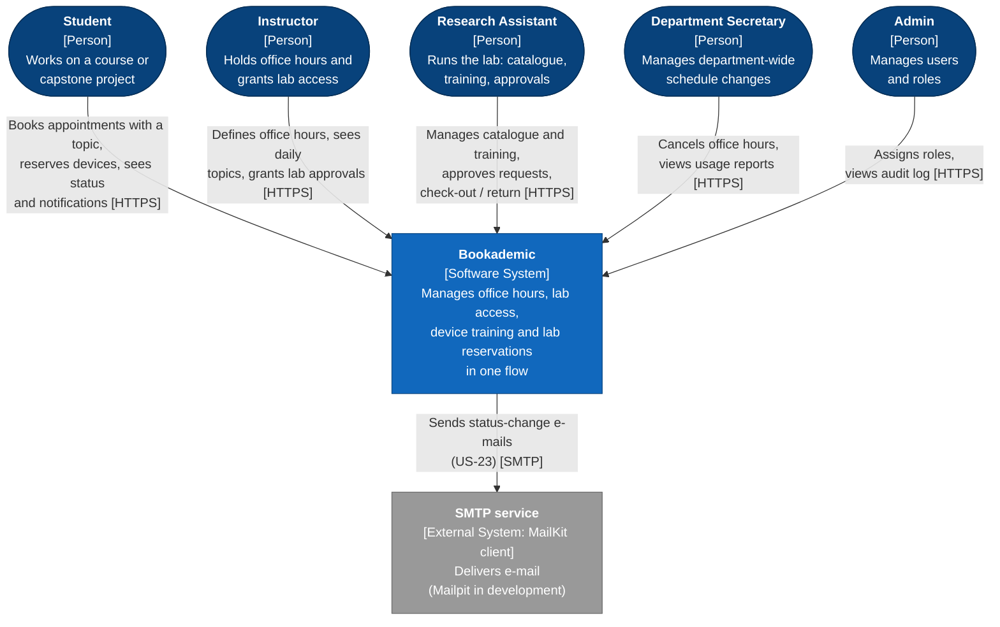
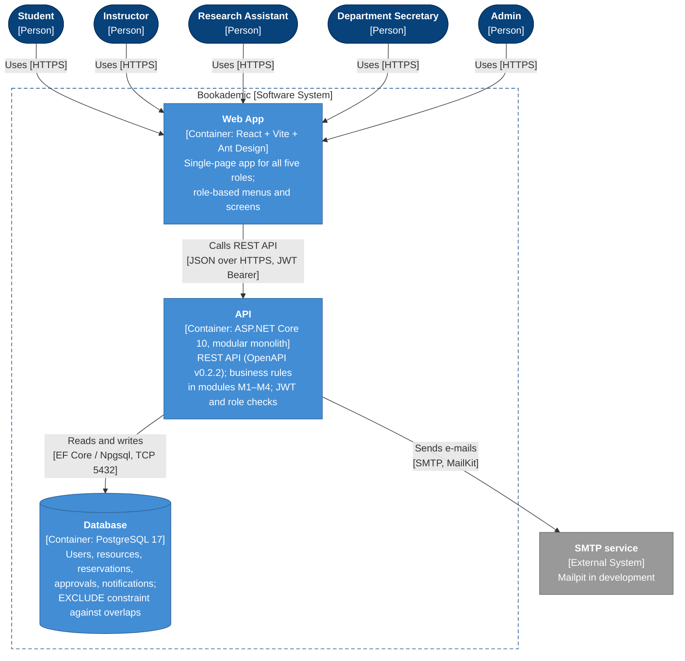
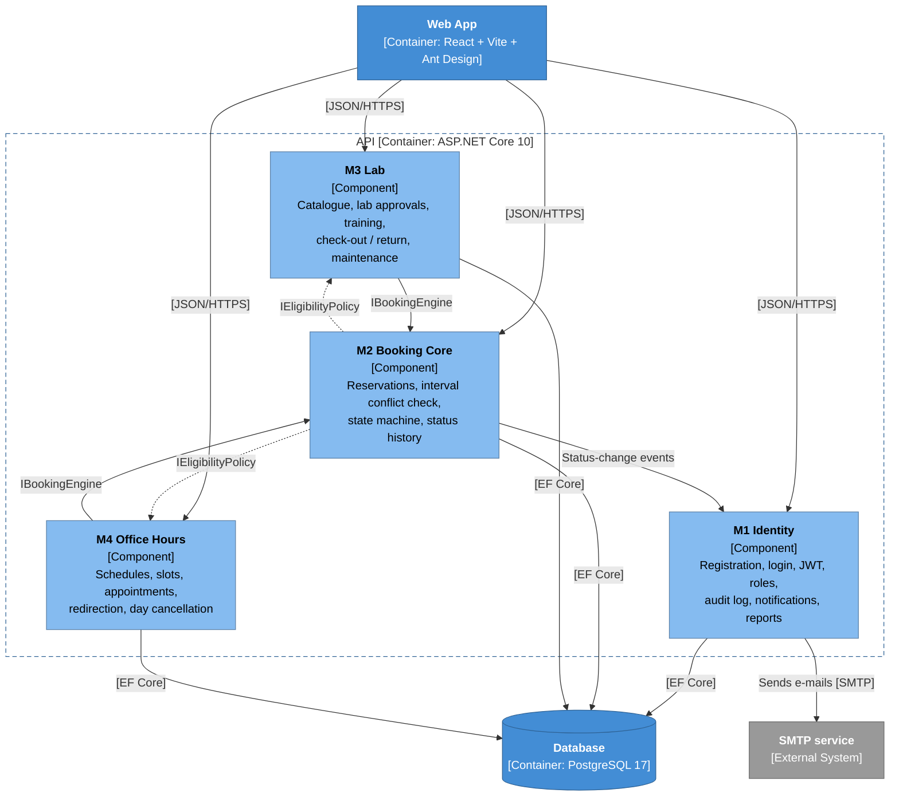

# Bookademic – C4 Architecture Model

| Field | Value |
|---|---|
| File | `docs/architecture/c4.md` |
| Sprint | 2 (Requirements & Architecture) |
| Owner | Mürsel – Lead Software Architect |
| Reviewer | Mehmet (container names must match `docker-compose.yml`) |
| Related | [ADR-0001](../adr/0001-tech-stack.md), [OpenAPI v0.2.2](../api/openapi.yaml), [UML](uml.md), [Database](database.md), [Deployment](deployment.md), [Sequences](sequence/) |

This document describes Bookademic with the [C4 model](https://c4model.com): **Level 1 System Context**, **Level 2 Containers** and **Level 3 Components** of the API. **Level 4 / Deployment** is in [`deployment.md`](deployment.md) (Mehmet). All names below are the team vocabulary from the Sprint 2 plan and are used unchanged in the SRS, UML, ERD, sequence diagrams and Figma.

**Notation**

| Colour | Element |
|---|---|
| Dark blue, rounded | Person |
| Blue | Software System in scope (Bookademic) |
| Mid blue | Container |
| Light blue | Component |
| Grey | External system |
| Dashed frame | System or container boundary |

Every box shows *name · [type: technology] · responsibility*; every arrow shows *what is exchanged [protocol]*.

---

## 1. Level 1 – System Context

Who uses Bookademic and which systems it depends on.

| Element | Type | Responsibility |
|---|---|---|
| Student | Person | Books office-hour, training and support appointments; reserves lab devices and rooms |
| Instructor | Person | Defines office hours; reads the topic of each appointment; grants category-based lab approval |
| Research Assistant | Person | Maintains the catalogue; runs training and support hours; approves lab requests; check-out, return, maintenance |
| Department Secretary | Person | Cancels an office-hour day for an instructor; reads usage reports |
| Admin | Person | Assigns roles to staff; reads the audit log |
| SMTP service | External system | Delivers e-mail notifications; Mailpit replaces it in development |

**Out of scope** (see `docs/sprint1/vision.md`): university SSO, external calendar sync, mobile apps. They are not drawn.

---

## 2. Level 2 – Containers

The deployable units inside Bookademic. Each container is one service in `docker-compose.yml`.

| Container | Technology | compose service | Port | Responsibility |
|---|---|---|---|---|
| Web App | React + Vite + Ant Design (JavaScript) | `web` | 5173 | UI for all roles; all API calls in `src/api/client.js`; never enforces business rules alone |
| API | ASP.NET Core 10, modular monolith | `api` | 8080 | Implements `docs/api/openapi.yaml`; authentication, authorisation, all business rules |
| Database | PostgreSQL 17 | `db` | 5432 | Persistent data; one schema per module; `EXCLUDE USING gist` prevents overlapping active reservations |
| SMTP service | External (MailKit client in API) | `mailpit` (development only) | 1025 / 8025 | E-mail delivery (US-23); not part of Bookademic, therefore outside the boundary |

**Why four compose services but three containers?** `mailpit` only stands in for the external SMTP service during development, so it is drawn as an external system here and as a node in the deployment view.

---

## 3. Level 3 – Components of the API

The API is a modular monolith. Each module is a component with its own schema and a public contract; modules never reference each other's internals (checked by architecture tests, ADR-0001).

Solid arrows are calls; dashed arrows from M2 are calls through the `IEligibilityPolicy` extension point, which M3 and M4 implement. Each module reads and writes only its own schema (`identity`, `booking`, `lab`, `office_hours`). M3 and M4 also publish approval, training, cancellation and redirect events to M1 for notifications; for readability only the M2 event arrow is drawn (details in 3.1).

### 3.1 Component responsibilities and interfaces

| Component | Responsibility | Provides (REST, OpenAPI tag) | Provides (in-process) | Uses | Owns data | Stories |
|---|---|---|---|---|---|---|
| **M1 Identity** | Registration with school e-mail, login and JWT issuing, role assignment and audit log; creates in-app notifications and sends e-mails; usage reports | `POST /auth/register`, `POST /auth/login`, `GET /users/me`, `PUT /admin/users/{userId}/role`, `GET /notifications`, `GET /reports/usage` | Current user and role for every request; notification event handlers | SMTP service | `users`, `notifications` | US-01–US-05, US-23 |
| **M2 Booking Core** | Shared engine for every bookable resource: validates the interval, asks the eligibility policy, checks conflicts, runs the `ReservationStatus` state machine, records status history | `GET/POST /reservations`, `GET /reservations/{id}`, `POST …/approve`, `POST …/reject`, `POST …/cancel`, `GET …/history`, `GET /me/calendar` | **`IBookingEngine`** (create, approve, reject, cancel, check-in, complete) | `IEligibilityPolicy` (implemented by M3, M4); M1 events | `reservations`, `status_changes` | US-06–US-10 |
| **M3 Lab** | Device and room catalogue; instructor lab approvals; device training authorisations; check-out code, return, maintenance | `GET/POST /resources`, `GET/PUT /resources/{id}`, `POST/DELETE /resources/{id}/maintenance`, `POST …/handover-code`, `POST …/check-in`, `POST …/return`, `GET/POST /lab-approvals`, `GET/POST /training-authorizations` | **`IEligibilityPolicy`** for resources of type `DEVICE` / `ROOM` (active lab approval + training for the category) | `IBookingEngine`; M4 appointment data for approvals and training | `resources`, `lab_approvals`, `training_authorizations` | US-11–US-16 |
| **M4 Office Hours** | Weekly office, support and training hours; slot generation; appointments with a topic; daily lists; redirection; day cancellation | `GET/POST /office-hours`, `GET /office-hours/{id}/slots`, `POST /office-hours/{id}/cancellations`, `POST /appointments`, `GET /appointments/incoming`, `GET /appointments/my`, `POST /appointments/{id}/redirect` | **`IEligibilityPolicy`** for appointments (one appointment per student per staff member per day) | `IBookingEngine` | `office_hour_schedules`, `slots`, `appointments` | US-17–US-22 |

### 3.2 Key interfaces

| Interface | Defined in | Implemented by | Purpose |
|---|---|---|---|
| `IBookingEngine` | `Bookademic.Booking.Contracts` (M2) | M2 | The only way M3 and M4 create a reservation or change its status. Guarantees one conflict rule and one state machine for all resources. |
| `IEligibilityPolicy` | `Bookademic.Booking.Contracts` (M2) | M3 (lab rule), M4 (appointment rule) | Resource-specific rules plugged into M2 (Strategy pattern). A new resource type is added by writing a new policy; M2 does not change. |

### 3.3 Architectural rules

1. Every appointment is a reservation in M2 (`ReservationKind = APPOINTMENT`); its id is the reservation id.
2. M3 and M4 reference only `Bookademic.Booking.Contracts`, never `Bookademic.Booking.Core`. This is enforced by ArchUnitNET tests in CI.
3. Overlaps are prevented twice: M2 checks first and returns `409 SLOT_UNAVAILABLE`; the `EXCLUDE USING gist` constraint in the Database rejects concurrent duplicates (SQLSTATE `23P01`), which the API maps to the same 409. See [database.md](database.md).
4. Errors leave the API as RFC 9457 problem details with a `code` from the OpenAPI `ErrorCode` enum.
5. A failed e-mail never rolls back a business operation; the in-app notification is still stored (US-04, US-23).

---

## 4. Consistency checks

| Check | Source of truth | Status |
|---|---|---|
| Container names and ports | `docker-compose.yml` (`web`, `api`, `db`, `mailpit`) | Matches |
| Component endpoints | `docs/api/openapi.yaml` tags M1–M4 (35 operations) | Every operation belongs to exactly one component |
| Entity and table names | Sprint 2 vocabulary; [uml.md](uml.md), [database.md](database.md) | Same names |
| Reservation statuses | `ReservationStatus` enum | Used unchanged in [uml.md](uml.md) |
