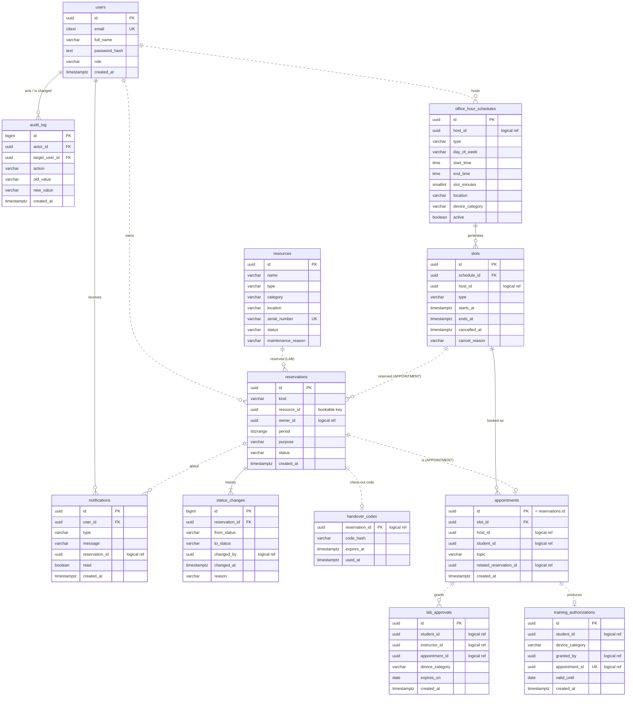

# Bookademic – Database Schema (ERD)

| Field | Value |
|---|---|
| File | `docs/architecture/database.md` |
| Sprint | 2 (Requirements & Architecture) |
| Owner | Mürsel – Lead Software Architect |
| Reviewer | Mirac (do the tables cover the functional requirements; are the constraints testable) |
| Related | [ADR-0001](../adr/0001-tech-stack.md), [UML class diagram](uml.md#2-domain-class-diagram), [C4 components](c4.md#3-level-3--components-of-the-api), [OpenAPI v0.2.2](../api/openapi.yaml) |

The **Database** container is a single PostgreSQL 17 database. Each API module owns one **schema** and is the only component that reads or writes its tables. Tables are created by EF Core code-first migrations (one `DbContext` per module).

| Module (C4 component) | Schema | Tables |
|---|---|---|
| M1 Identity | `identity` | `users`, `notifications`, `audit_log` |
| M2 Booking Core | `booking` | `reservations`, `status_changes` |
| M3 Lab | `lab` | `resources`, `lab_approvals`, `training_authorizations`, `handover_codes` |
| M4 Office Hours | `office_hours` | `office_hour_schedules`, `slots`, `appointments` |

Table names are the entity names from the Sprint 2 vocabulary in snake_case plural. `audit_log` and `handover_codes` are new names introduced here (for US-03 and US-15) and are added to the vocabulary.

---

## 1. Entity-relationship diagram



**Solid lines** are foreign keys inside one module (enforced by PostgreSQL). **Dashed lines** are cross-module references: the column stores the id, but there is no database foreign key, so modules stay independent (ADR-0001). The owning module checks these references through the other module's public contract.

---

## 2. Tables

Types are PostgreSQL types. All `id` columns are UUIDs generated by the API; the API exposes them as strings (the `RSV-1048` style ids in OpenAPI are illustrative examples). All timestamps are `timestamptz` (stored in UTC, shown in Europe/Istanbul). Enum columns are `varchar` with a `CHECK` constraint listing exactly the OpenAPI enum values.

### 2.1 Schema `identity` (M1 Identity)

**`users`**

| Column | Type | Null | Constraint | OpenAPI field |
|---|---|---|---|---|
| id | uuid | no | PK | `User.id` |
| email | citext | no | UNIQUE; school domain checked in the API | `User.email` |
| full_name | varchar(100) | no | length ≥ 2 | `User.fullName` |
| password_hash | text | no | ASP.NET Core `PasswordHasher` output; never returned | – |
| role | varchar(20) | no | CHECK in (STUDENT, INSTRUCTOR, RESEARCH_ASSISTANT, SECRETARY, ADMIN); default STUDENT | `User.role` |
| created_at | timestamptz | no | default `now()` | – |

**`notifications`**

| Column | Type | Null | Constraint | OpenAPI field |
|---|---|---|---|---|
| id | uuid | no | PK | `Notification.id` |
| user_id | uuid | no | FK → `users.id` ON DELETE CASCADE | – |
| type | varchar(30) | no | CHECK in `NotificationType` values | `Notification.type` |
| message | varchar(500) | no | | `Notification.message` |
| reservation_id | uuid | yes | logical ref → `booking.reservations.id` | `Notification.reservationId` |
| read | boolean | no | default false | `Notification.read` |
| created_at | timestamptz | no | default `now()` | `Notification.createdAt` |

**`audit_log`** (US-03, FR-M1-06: every role change is recorded; entity name **AuditLog**, resolves SRS open point C2)

| Column | Type | Null | Constraint |
|---|---|---|---|
| id | bigint | no | PK, identity |
| actor_id | uuid | no | FK → `users.id` |
| target_user_id | uuid | no | FK → `users.id` |
| action | varchar(30) | no | e.g. `ROLE_CHANGED` |
| old_value | varchar(50) | yes | |
| new_value | varchar(50) | yes | |
| created_at | timestamptz | no | default `now()` |

### 2.2 Schema `booking` (M2 Booking Core)

**`reservations`**: one row for every lab reservation **and** every appointment.

| Column | Type | Null | Constraint | OpenAPI field |
|---|---|---|---|---|
| id | uuid | no | PK | `Reservation.id` (= `Appointment.id`) |
| kind | varchar(12) | no | CHECK in (LAB, APPOINTMENT) | `Reservation.kind` |
| resource_id | uuid | no | **bookable key**: `lab.resources.id` for LAB, `office_hours.slots.id` for APPOINTMENT (logical ref) | `Reservation.resourceId` |
| owner_id | uuid | no | logical ref → `identity.users.id` | `Reservation.ownerId` |
| period | tstzrange | no | half-open `[start, end)`; CHECK `NOT isempty(period) AND lower_inc(period) AND NOT upper_inc(period)` | `startsAt` = `lower(period)`, `endsAt` = `upper(period)` |
| purpose | varchar(500) | yes | | `Reservation.purpose` |
| status | varchar(12) | no | CHECK in (PENDING, APPROVED, REJECTED, CANCELLED, CHECKED_IN, COMPLETED) | `Reservation.status` |
| created_at | timestamptz | no | default `now()` | `Reservation.createdAt` |

Plus the **`EXCLUDE` constraint** in section 3.

**`status_changes`**: append-only history; one row per transition, including creation.

| Column | Type | Null | Constraint | OpenAPI field |
|---|---|---|---|---|
| id | bigint | no | PK, identity | – |
| reservation_id | uuid | no | FK → `reservations.id` ON DELETE CASCADE | – |
| from_status | varchar(12) | yes | null for the creation event | `StatusChange.from` |
| to_status | varchar(12) | no | same CHECK as `reservations.status` | `StatusChange.to` |
| changed_by | uuid | no | logical ref → `identity.users.id` | `StatusChange.changedBy` |
| changed_at | timestamptz | no | default `now()` | `StatusChange.changedAt` |
| reason | varchar(500) | yes | required by the API for reject (≥ 5 characters) | `StatusChange.reason` |

### 2.3 Schema `lab` (M3 Lab)

**`resources`**

| Column | Type | Null | Constraint | OpenAPI field |
|---|---|---|---|---|
| id | uuid | no | PK | `Resource.id` |
| name | varchar(120) | no | | `Resource.name` |
| type | varchar(10) | no | CHECK in (DEVICE, ROOM) | `Resource.type` |
| category | varchar(60) | no | e.g. Oscilloscope | `Resource.category` |
| location | varchar(120) | no | | `Resource.location` |
| serial_number | varchar(60) | yes | UNIQUE (→ 409 `DUPLICATE_SERIAL_NUMBER`) | `Resource.serialNumber` |
| status | varchar(12) | no | CHECK in (AVAILABLE, MAINTENANCE); default AVAILABLE | `Resource.status` |
| maintenance_reason | varchar(500) | yes | set while in maintenance | `MaintenanceRequest.reason` |

**`lab_approvals`** (US-13)

| Column | Type | Null | Constraint | OpenAPI field |
|---|---|---|---|---|
| id | uuid | no | PK | `LabApproval.id` |
| student_id | uuid | no | logical ref → `identity.users.id` | `LabApproval.studentId` |
| instructor_id | uuid | no | logical ref → `identity.users.id` | `LabApproval.instructorId` |
| appointment_id | uuid | no | logical ref → `office_hours.appointments.id` (an OFFICE_HOUR appointment hosted by the instructor) | `LabApproval.appointmentId` |
| device_category | varchar(60) | no | | `LabApproval.deviceCategory` |
| expires_on | date | no | CHECK `expires_on >= created_at::date` (a date before today → 400, SRS C3) | `LabApproval.expiresOn` |
| created_at | timestamptz | no | default `now()` | `LabApproval.createdAt` |

`LabApproval.active` is **not stored**; it is computed as `expires_on >= current_date` so it can never be out of date.

**`training_authorizations`** (US-14)

| Column | Type | Null | Constraint | OpenAPI field |
|---|---|---|---|---|
| id | uuid | no | PK | `TrainingAuthorization.id` |
| student_id | uuid | no | logical ref → `identity.users.id` | `TrainingAuthorization.studentId` |
| device_category | varchar(60) | no | UNIQUE (`student_id`, `device_category`) → 409 `TRAINING_ALREADY_GRANTED` | `TrainingAuthorization.deviceCategory` |
| granted_by | uuid | no | logical ref → `identity.users.id` (research assistant) | `TrainingAuthorization.grantedBy` |
| appointment_id | uuid | no | UNIQUE; logical ref → `office_hours.appointments.id` (a TRAINING appointment) | `TrainingAuthorization.appointmentId` |
| valid_until | date | no | end of the current semester | `TrainingAuthorization.validUntil` |
| created_at | timestamptz | no | default `now()` | – |

**`handover_codes`** (US-15, Should)

| Column | Type | Null | Constraint |
|---|---|---|---|
| reservation_id | uuid | no | PK; logical ref → `booking.reservations.id` (an APPROVED lab reservation) |
| code_hash | varchar(100) | no | hash of the 6-digit code; the code itself is never stored |
| expires_at | timestamptz | no | |
| used_at | timestamptz | yes | set at check-in; a used code cannot be reused |

### 2.4 Schema `office_hours` (M4 Office Hours)

**`office_hour_schedules`** (US-17)

| Column | Type | Null | Constraint | OpenAPI field |
|---|---|---|---|---|
| id | uuid | no | PK | `OfficeHourSchedule.id` |
| host_id | uuid | no | logical ref → `identity.users.id` | `OfficeHourSchedule.hostId` |
| type | varchar(12) | no | CHECK in (OFFICE_HOUR, SUPPORT, TRAINING) | `type` |
| day_of_week | varchar(9) | no | CHECK in (MONDAY … SUNDAY) | `dayOfWeek` |
| start_time | time | no | | `startTime` |
| end_time | time | no | CHECK `end_time > start_time` | `endTime` |
| slot_minutes | smallint | no | CHECK between 10 and 120 | `slotMinutes` |
| location | varchar(120) | no | | `location` |
| device_category | varchar(60) | yes | CHECK `type <> 'TRAINING' OR device_category IS NOT NULL` | `deviceCategory` |
| active | boolean | no | default true | `active` |

**`slots`**

| Column | Type | Null | Constraint | OpenAPI field |
|---|---|---|---|---|
| id | uuid | no | PK | `Slot.id` |
| schedule_id | uuid | no | FK → `office_hour_schedules.id` ON DELETE CASCADE | `Slot.scheduleId` |
| host_id | uuid | no | copied from the schedule for fast queries | `Slot.hostId` |
| type | varchar(12) | no | copied from the schedule | `Slot.type` |
| starts_at | timestamptz | no | UNIQUE (`schedule_id`, `starts_at`) | `Slot.startsAt` |
| ends_at | timestamptz | no | CHECK `ends_at > starts_at` | `Slot.endsAt` |
| cancelled_at | timestamptz | yes | set by a day cancellation (US-20) | – |
| cancel_reason | varchar(500) | yes | | `DayCancellationRequest.reason` |

`Slot.available` is **not stored**: a slot is available when it is not cancelled and has no active reservation (`PENDING`, `APPROVED`, `CHECKED_IN`) in `booking.reservations`.

**`appointments`** (US-18 – US-22): the M4 extension of an `APPOINTMENT` reservation.

| Column | Type | Null | Constraint | OpenAPI field |
|---|---|---|---|---|
| id | uuid | no | PK; **same value as `booking.reservations.id`** (1:1) | `Appointment.id` |
| slot_id | uuid | no | FK → `slots.id` | `Appointment.slotId` |
| host_id | uuid | no | logical ref → `identity.users.id` | `Appointment.hostId` |
| student_id | uuid | no | logical ref → `identity.users.id` | `Appointment.studentId` |
| topic | varchar(500) | no | CHECK `char_length(btrim(topic)) BETWEEN 10 AND 500` | `Appointment.topic` |
| related_reservation_id | uuid | yes | logical ref → own APPROVED or CHECKED_IN lab reservation (US-22) | `Appointment.relatedReservationId` |
| created_at | timestamptz | no | default `now()` | – |

`status`, `startsAt` and `endsAt` of an appointment are read from `booking.reservations` (single source of truth); `scheduleType` and `location` from the slot and its schedule.

---

## 3. Overlap protection: `EXCLUDE USING gist`

The most important constraint of the system. It guarantees that **no two active reservations share the same bookable key and overlapping time**, even when two requests arrive at the same moment.

```sql
CREATE EXTENSION IF NOT EXISTS btree_gist;

ALTER TABLE booking.reservations
  ADD CONSTRAINT no_overlapping_active_reservations
  EXCLUDE USING gist (
    resource_id WITH =,
    period      WITH &&
  )
  WHERE (status IN ('PENDING', 'APPROVED', 'CHECKED_IN'));
```

| Aspect | Explanation |
|---|---|
| `btree_gist` | Lets a GiST index compare the `uuid` column with `=` next to the range column. |
| `resource_id WITH =` | Same device/room (LAB) or same slot (APPOINTMENT). |
| `period WITH &&` | Time ranges overlap. Ranges are half-open `[start, end)`, so 10:00–11:00 and 11:00–12:00 **do not** overlap (US-07). |
| `WHERE status IN (…)` | Only active reservations block a time. A `CANCELLED`, `REJECTED` or `COMPLETED` interval can be booked again immediately. |
| Error mapping | M2 first checks with a query and returns `409 SLOT_UNAVAILABLE`. If two requests still pass the check together, PostgreSQL rejects the second with SQLSTATE `23P01` (exclusion violation); the API maps it to the same 409. |
| Test | Integration test with Testcontainers: two parallel `POST /reservations` for the same interval → exactly one 201 and one 409, one row in the table (`docs/test-plan.md`). |

Rules that span more than one table are enforced by the API, not by a constraint: one appointment per student per staff member per day (M4 `IEligibilityPolicy`), active lab approval and training before a lab reservation (M3 `IEligibilityPolicy`), and no overlapping schedules for the same host (`409 SCHEDULE_OVERLAP`).

---

## 4. Indexes

Primary keys and `UNIQUE` constraints create their own indexes. Additional indexes follow the main queries in OpenAPI.

| Index | Table | Columns | Serves |
|---|---|---|---|
| `no_overlapping_active_reservations` (GiST) | `booking.reservations` | `resource_id`, `period` (partial) | Overlap check, availability filter in `GET /resources` |
| `ix_reservations_owner_start` | `booking.reservations` | `owner_id`, `lower(period)` | `GET /me/calendar`, `GET /reservations` (own) |
| `ix_reservations_kind_status` | `booking.reservations` | `kind`, `status` | Approval queue `GET /reservations?kind=LAB&status=PENDING` |
| `ix_status_changes_reservation` | `booking.status_changes` | `reservation_id`, `changed_at` | `GET /reservations/{id}/history` |
| `ix_notifications_user_unread` | `identity.notifications` | `user_id`, `read`, `created_at DESC` | `GET /notifications?unreadOnly=true` |
| `ix_resources_type_category` | `lab.resources` | `type`, `category` | Catalogue filters (US-12, p95 < 200 ms on 500 records) |
| `ix_lab_approvals_student_category` | `lab.lab_approvals` | `student_id`, `device_category`, `expires_on` | Eligibility check before a lab reservation |
| `ix_slots_host_start` | `office_hours.slots` | `host_id`, `starts_at` | Free slots, daily lists, day cancellation |
| `ix_appointments_host` | `office_hours.appointments` | `host_id`, `created_at` | `GET /appointments/incoming` |
| `ix_appointments_student` | `office_hours.appointments` | `student_id` | `GET /appointments/my`, daily limit check |

---

## 5. Data protection (KVKK)

- Only the data the system needs is stored: name, school e-mail, role. No student number, phone or address.
- Passwords are stored only as hashes; handover codes only as hashes.
- Test and demo data are synthetic (seed script); no real student data is used (`docs/test-plan.md`).
- Deleting a user cascades to their notifications; reservations keep the owner id for the audit trail.

---

## 6. Consistency checks

| Check | Source of truth | Status |
|---|---|---|
| Table names | Sprint 2 vocabulary (snake_case plural of entity names) | Matches; `audit_log`, `handover_codes` added |
| Columns | OpenAPI v0.2.2 schemas and [UML class diagram](uml.md) | Every OpenAPI field maps to a column or a derived value |
| Enum values | OpenAPI enums | Identical `CHECK` lists |
| Module ownership | [C4 Level 3](c4.md) | One schema per component |
| Overlap rule | ADR-0001 | Same constraint and statuses |
