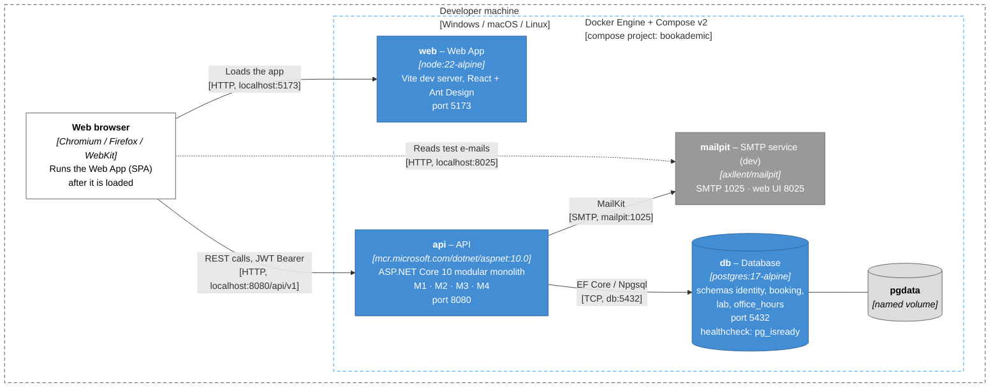

# Bookademic – Deployment (C4 Level 4)

| Field | Value |
|---|---|
| File | `docs/architecture/deployment.md` |
| Sprint | 2 (Requirements & Architecture) |
| Issue | #71 |
| Owner | Mehmet – DevOps |
| Reviewer | Mürsel |
| Source of truth | [`docker-compose.yml`](../../docker-compose.yml), [`.env.example`](../../.env.example) |
| Related | [C4 Level 1–3](c4.md), [ADR-0001](../adr/0001-tech-stack.md), [ADR-0002](../adr/0002-authentication-with-jwt.md), [NFR](../sprint2/nfr.md) (NFR-PORT-01 … 04, NFR-REL-07) |

This view shows where the containers of the [C4 Level 2 diagram](c4.md#2-level-2--containers) run. In Sprint 2 and Sprint 3 there is **one environment: the developer machine**. Every team member runs the whole system with Docker Compose. There is no shared server or cloud deployment in the course scope.

The names are the same as in the other diagrams: the **Web App**, **API** and **Database** containers run as the compose services `web`, `api` and `db`. The external **SMTP service** is replaced by `mailpit` in development.

---

## 1. Deployment diagram



**How a request flows.** The browser loads the Web App from `web` once. After that, the single-page application in the browser calls the API **directly** at `localhost:8080/api/v1` (`VITE_API_BASE_URL`). The `web` container does not proxy API calls. Inside the compose network, `api` reaches `db` and `mailpit` by their service names.

**HTTP vs. HTTPS.** The C4 container diagram labels connections as HTTPS, because a real deployment would run behind TLS. On the developer machine everything is plain HTTP on `localhost` (ADR-0002, follow-ups).

---

## 2. Services

Values are taken from `docker-compose.yml`.

| Service | C4 element | Image | Host port → container port | Depends on | Health / state |
|---|---|---|---|---|---|
| `db` | Database (container) | `postgres:17-alpine` | `5432 → 5432` | – | Healthcheck `pg_isready` every 5 s, timeout 3 s, 10 retries |
| `mailpit` | SMTP service (external system, development stand-in) | `axllent/mailpit:latest` | `1025 → 1025` (SMTP), `8025 → 8025` (web UI) | – | Started |
| `api` | API (container) | `mcr.microsoft.com/dotnet/aspnet:10.0` | `8080 → 8080` | `db` (**service_healthy**), `mailpit` (service_started) | No healthcheck yet (see section 5) |
| `web` | Web App (container) | `node:22-alpine` | `5173 → 5173` | `api` (started) | No healthcheck yet |

**Start order.** `db` and `mailpit` start first. `api` waits until `db` reports healthy, then `web` starts after `api`.

**Volume.** `pgdata` is a named volume mounted at `/var/lib/postgresql/data`. `docker compose down` keeps it, so data survives a restart. Only `docker compose down -v` deletes it (resetting the database to empty).

**Network.** Compose creates one default network for the project. Service names (`db`, `mailpit`, `api`) are the host names inside it. Only the ports in the table are published to the host.

**Placeholders in Sprint 2.** `api` and `web` currently run `sleep infinity` on their base images, because there is no application code yet. In Sprint 3 they are replaced by `build: ./backend` (multi-stage Dockerfile `sdk:10.0` → `aspnet:10.0`, ADR-0001) and `build: ./web`. Ports, service names and environment variables stay the same, so this diagram does not change.

---

## 3. Environment variables

All configuration comes from environment variables (NFR-PORT-04). Defaults are development values only. A real `.env` file is never committed (NFR-SEC-07).

| Variable (in `.env`) | Used by | Passed to the container as | Default (development) | Purpose |
|---|---|---|---|---|
| `POSTGRES_USER` | `db`, `api` | `POSTGRES_USER`; part of `ConnectionStrings__Default` | `bookademic` | Database user |
| `POSTGRES_PASSWORD` | `db`, `api` | `POSTGRES_PASSWORD`; part of `ConnectionStrings__Default` | `bookademic` | Database password |
| `POSTGRES_DB` | `db`, `api` | `POSTGRES_DB`; part of `ConnectionStrings__Default` | `bookademic` | Database name |
| `JWT_SIGNING_KEY` | `api` | `Jwt__SigningKey` | development key of 45 characters | HS256 signing key, at least 32 bytes (ADR-0002). The API refuses to start without it |
| – (fixed in compose) | `api` | `ASPNETCORE_URLS` = `http://+:8080` | – | Port Kestrel listens on |
| – (fixed in compose) | `api` | `ConnectionStrings__Default` = `Host=db;Port=5432;Database=…;Username=…;Password=…` | built from the `POSTGRES_*` values | EF Core / Npgsql connection |
| – (fixed in compose) | `api` | `Smtp__Host` = `mailpit`, `Smtp__Port` = `1025` | – | MailKit target (ADR-0003) |
| – (fixed in compose) | `web` | `VITE_API_BASE_URL` = `http://localhost:8080/api/v1` | – | Base URL used by `src/api/client.js` |

Every variable that `docker-compose.yml` reads from `.env` is listed in `.env.example` (NFR-PORT-04).

---

## 4. Running it

```bash
git clone https://github.com/bookademic-team/Bookademic.git
cd Bookademic
cp .env.example .env        # optional: the defaults already work
docker compose up
```

| URL | What |
|---|---|
| http://localhost:5173 | Web App |
| http://localhost:8080/api/v1 | API (from Sprint 3) |
| http://localhost:8025 | Mailpit inbox (all e-mails sent by the API) |
| `localhost:5432` | PostgreSQL, e.g. for a database client |

**Host requirement:** only Docker Engine with Compose v2 (NFR-PORT-03). If a port is already used on the host (for example a local PostgreSQL on 5432), stop that program or change the left side of the port mapping in `docker-compose.yml`.

---

## 5. Input for the NFRs (O4 in `nfr.md`)

| NFR | What the deployment provides | Status in Sprint 2 | Open for Sprint 3 |
|---|---|---|---|
| NFR-PORT-01 – start with one command | `cp .env.example .env` + `docker compose up`; four services | All four services start; `db` becomes healthy | `api` and `web` built from Dockerfiles |
| NFR-PORT-02 – start-up time | Small Alpine images for `db`, `web`, `mailpit` | Can only be measured when `api` is built | Measure first build (≤ 5 min) and cached start (≤ 60 s) |
| NFR-PORT-03 – only Docker on the host | No other host tool is needed | Met | Confirm on every team machine |
| NFR-PORT-04 – configuration from environment | Section 3; `.env.example` complete | Met | CI comparison script (EN-04) |
| NFR-REL-07 – data survives restart, stack recovers | Named volume `pgdata`; `db` healthcheck; `api` waits for a healthy `db` | Volume and healthcheck in place | Add a healthcheck to `api` (`GET /health`) and `restart: unless-stopped` to `api` and `web`, so "api healthy ≤ 60 s" can be measured |

**Further follow-ups (Sprint 3):** pin `axllent/mailpit` to a fixed version instead of `latest`, so every machine uses the same image.

---

## 6. Consistency checks

| Check | Source of truth | Status |
|---|---|---|
| Service names, images, ports, volume, healthcheck, dependencies | `docker-compose.yml` | Identical |
| Container names | [C4 Level 2](c4.md#2-level-2--containers) | Web App = `web`, API = `api`, Database = `db`, SMTP service = `mailpit` (dev) |
| JWT signing key | ADR-0002 follow-up | `JWT_SIGNING_KEY` in `.env.example`, passed as `Jwt__SigningKey` |
| Modules inside `api` | [C4 Level 3](c4.md#3-level-3--components-of-the-api) | M1 Identity, M2 Booking Core, M3 Lab, M4 Office Hours in one process |
