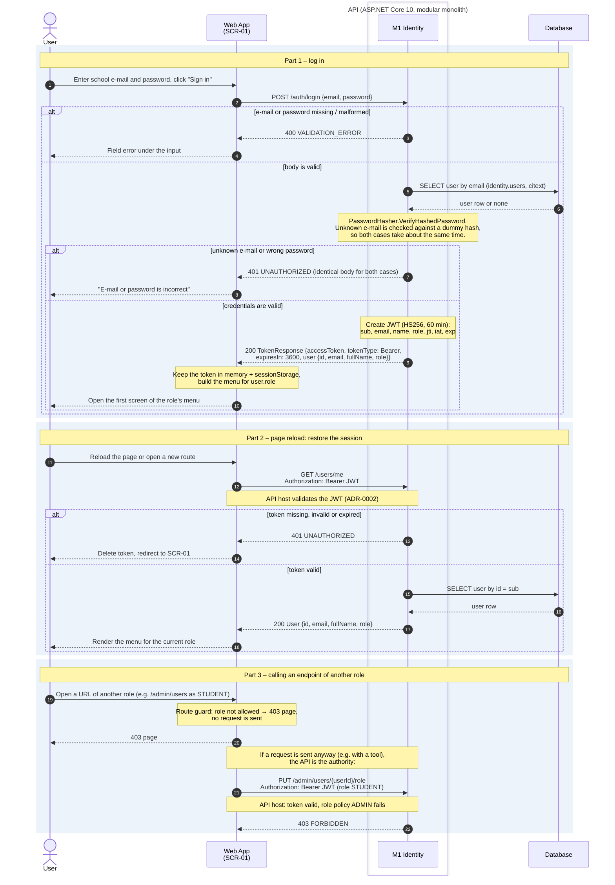

# US-02 – Log In and Role-Based Access (Sequence Diagram)

| Field | Value |
|---|---|
| File | `docs/architecture/sequence/US-02.md` |
| Sprint | 2 (Requirements & Architecture) |
| Owner | Mehmet – DevOps, story owner of US-02 |
| Reviewer | Mürsel |
| Story | **US-02** – As a user, I want to log in and access the screens for my role. (Must, 3 SP) |
| Requirements | FR-M1-03, FR-M1-04 ([`srs.md`](../../sprint2/srs.md)) |
| Use case | UC-8 Sign in / register |
| Screen | SCR-01 Sign In & Register; role-based menu and 403 page ([`ui-screens.md`](../../ui-screens.md)) |
| Endpoints (OpenAPI v0.2.3) | `POST /auth/login` (login), `GET /users/me` (getCurrentUser), any protected endpoint |
| Related | [C4 components](../c4.md#3-level-3--components-of-the-api), [Database](../database.md), [ADR-0002](../../adr/0002-authentication-with-jwt.md), [NFR](../../sprint2/nfr.md) (NFR-SEC-04, NFR-SEC-05) |

Participants use the C4 names: the **User** (any of the five roles), the **Web App** and **API** containers, the **M1 Identity** component inside the API, and the **Database** container. Token validation on protected endpoints is done by the API host's JWT middleware before any module code runs (ADR-0002); it is shown as a note.

---

## 1. Diagram

---

## 2. Steps

| Step(s) | What happens | Component | Result | Requirement |
|---|---|---|---|---|
| 1–2 | The user signs in on SCR-01; the Web App sends `POST /auth/login` | Web App → M1 | – | FR-M1-03 |
| 3–4 | Missing or malformed e-mail/password | M1 Identity | `400 VALIDATION_ERROR` | FR-M1-03 |
| 5–6 | M1 reads the user by e-mail (`citext`, case-insensitive) and verifies the password hash | M1 → Database | – | FR-M1-03, NFR-SEC-04 |
| 7–8 | Unknown e-mail and wrong password give the **same** `401` body; a dummy hash check keeps the response time similar | M1 Identity | `401 UNAUTHORIZED` | FR-M1-03, NFR-SEC-05 |
| 9 | M1 creates the JWT with the claims of ADR-0002 and returns `TokenResponse` | M1 Identity | `200` | FR-M1-03 |
| 10 | The Web App stores the token (memory + `sessionStorage`, ADR-0002) and shows only the screens of the role | Web App | Role menu | FR-M1-04 |
| 11–18 | After a reload, `GET /users/me` restores the user and role. A missing, invalid or expired token gives `401` and the Web App returns to SCR-01 | Web App → M1 | `200` / `401` | FR-M1-04 |
| 19–22 | A route of another role shows the 403 page without calling the API. A direct API call with the wrong role is rejected by the role policy | Web App, API host | 403 page / `403 FORBIDDEN` | FR-M1-04 |

The token's role stays the same until the token expires. After an admin changes a user's role (US-03), the new role applies at the next login, at most 60 minutes later (ADR-0002, consequences).

---

## 3. Acceptance criteria covered

| US-02 acceptance criterion | Where in the diagram |
|---|---|
| Valid credentials → 200 + JWT | Part 1, "credentials are valid" |
| Invalid credentials → 401 | Part 1, "unknown e-mail or wrong password" |
| No token → 401 | Part 2, "token missing, invalid or expired" |
| Unauthorized role → 403 `FORBIDDEN` | Part 3 |
| `GET /users/me` returns the caller's role | Part 2, "token valid" |

Test cases: [test-plan.md](../../test-plan.md) and the authentication tests listed in ADR-0002, section 6 (no / malformed / expired token, wrong signature, wrong role, identical 401 bodies).
