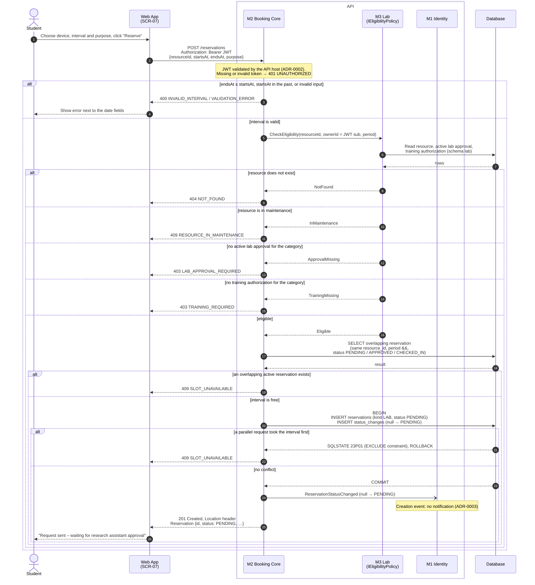

# US-06 – Reserve a Lab Device (Sequence Diagram)

| Field | Value |
|---|---|
| File | `docs/architecture/sequence/US-06.md` |
| Sprint | 2 (Requirements & Architecture) |
| Owner | Mürsel – Lead Software Architect (story owner of US-06) |
| Reviewer | Emir |
| Story | **US-06** – As a student, I want to reserve a time slot for a lab device. (Must, 8 SP) |
| Requirements | FR-M2-01 … FR-M2-05 – `docs/sprint2/srs.md` |
| Use case | UC-3 Reserve and check out a lab device |
| Screen | SCR-07 Lab Catalog & Reservation |
| Endpoint | `POST /reservations` (`createReservation`) – OpenAPI v0.2.3 |
| Related | [C4 components](../c4.md#3-level-3--components-of-the-api), [Database](../database.md#3-overlap-protection-exclude-using-gist), [ADR-0001](../../adr/0001-tech-stack.md), [ADR-0002](../../adr/0002-authentication-with-jwt.md), [ADR-0003](../../adr/0003-notification-events-and-appointment-completion.md) |

Participants use the names from the C4 diagrams: the **Student** person, the **Web App** and **API** containers, the **M1 Identity**, **M2 Booking Core** and **M3 Lab** components inside the API, and the **Database** container.

---

## 1. Diagram

The error branches all return to the Web App, which shows the problem `title` and `detail` (RFC 9457) to the student. To keep the diagram readable, the "show error" step is drawn only once, in the first branch.

---

## 2. Steps

| Step | What happens | Component | Result |
|---|---|---|---|
| 1–2 | The student fills in the reservation form on SCR-07; the Web App sends `POST /reservations` with the JWT | Web App → API | – |
| – | The API host validates the token before any module code runs | API (ADR-0002) | 401 `UNAUTHORIZED` |
| 3–4 | M2 validates the input: required fields, `endsAt > startsAt`, `startsAt` not in the past (SRS C1), purpose ≤ 500 characters | M2 Booking Core | 400 `INVALID_INTERVAL` / `VALIDATION_ERROR` |
| 5–7 | M2 asks the eligibility policy registered for lab resources; M3 reads its own tables. M2 does not know lab rules (ADR-0001, rule 2) | M2 → M3 via `IEligibilityPolicy` | – |
| 8–11 | Resource missing or in maintenance | M3 Lab | 404 `NOT_FOUND`, 409 `RESOURCE_IN_MAINTENANCE` |
| 12–15 | No active `LabApproval` (`expires_on ≥ today`) or no `TrainingAuthorization` for the device category | M3 Lab | 403 `LAB_APPROVAL_REQUIRED`, 403 `TRAINING_REQUIRED` |
| 16–19 | M2 looks for an active reservation that overlaps the interval; half-open ranges, so 10:00–11:00 and 11:00–12:00 do not overlap (US-07) | M2 → Database | 409 `SLOT_UNAVAILABLE` |
| 20–22 | Reservation and its first history row are written in one transaction. If a parallel request passed step 17 at the same moment, the `EXCLUDE USING gist` constraint rejects the second insert | M2 → Database | 409 `SLOT_UNAVAILABLE` |
| 23–24 | After commit, M2 publishes `ReservationStatusChanged`; the creation event does not produce a notification | M2 → M1 (ADR-0003) | – |
| 25–26 | `201 Created` with the reservation in status `PENDING`; the request appears in the research assistant's approval queue (US-08) | M2 → Web App | 201 |

The order of the checks is the order written in the OpenAPI description of `createReservation`: interval (400) → resource exists (404) → maintenance (409) → eligibility (403) → conflict (409).

---

## 3. Acceptance criteria covered

| US-06 acceptance criterion | Where in the diagram |
|---|---|
| End before start → 400 `INVALID_INTERVAL` | First `alt` branch |
| Start in the past → 400 `INVALID_INTERVAL` | First `alt` branch |
| Device under maintenance → 409 `RESOURCE_IN_MAINTENANCE` | Eligibility branch "resource is in maintenance" |
| No valid lab approval → 403 `LAB_APPROVAL_REQUIRED` | Eligibility branch "no active lab approval" |
| No training authorization → 403 `TRAINING_REQUIRED` | Eligibility branch "no training authorization" |
| Overlaps a pending, approved or checked-in booking → 409 `SLOT_UNAVAILABLE`, also under concurrent requests | Overlap query and `EXCLUDE` constraint branches |
| On success 201 + `PENDING` | Last branch |

These are the cases tested in US-07 (unit tests for the policy and conflict check, Testcontainers test for two parallel requests).
