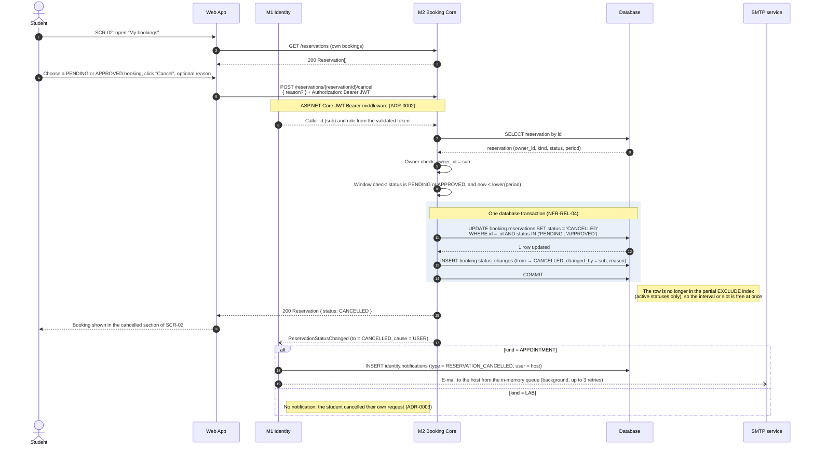
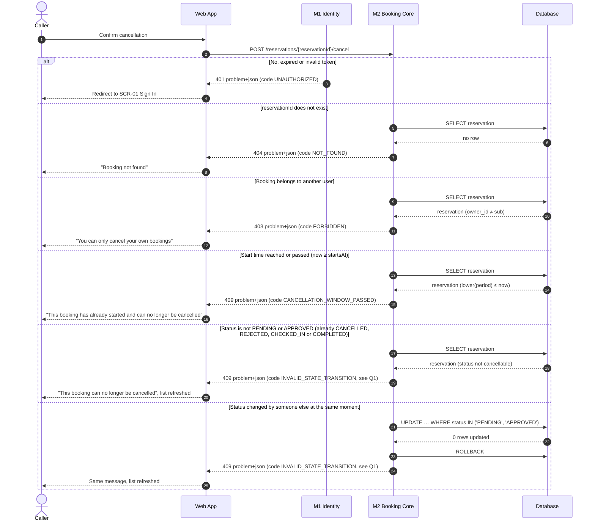

# Sequence Diagram – US-09 Cancel a Reservation or Appointment

| Field | Value |
|---|---|
| File | `docs/architecture/sequence/US-09.md` |
| Sprint | 2 (Requirements & Architecture) – deliverable 4 |
| Owner | Sıla – Scrum Master & Agile Process Coach |
| Reviewer | Mürsel – Lead Software Architect |
| Issue | #68 (US-09: #13) |
| Requirement | FR-M2-10 |
| Use cases | UC-3 Reserve and check out a lab device, UC-1 Get lab access approval (appointment) |
| Screens | SCR-02 Calendar & My Appointments, CMP-01 Notification Center |
| Endpoint | `POST /reservations/{reservationId}/cancel` (OpenAPI v0.2.3, tag `M2 Booking Core`, operation `cancelReservation`) |
| Related | [C4 components](../c4.md#3-level-3--components-of-the-api), [UML state machine](../uml.md), [Database schema](../database.md), [ADR-0002](../../adr/0002-authentication-with-jwt.md), [ADR-0003](../../adr/0003-notification-events-and-appointment-completion.md), [Test plan](../../test-plan.md) |

## 1. Story and acceptance criteria

> **US-09:** As a student, I want to cancel my reservation or appointment.
>
> **Acceptance criteria:** Can be cancelled before the start time, otherwise 409 `CANCELLATION_WINDOW_PASSED`; another user's booking → 403; the status becomes `CANCELLED` and the slot is freed immediately.

One endpoint cancels both kinds of booking, because every appointment is also a reservation in M2 Booking Core (`kind = APPOINTMENT`, same id). M2 owns the status; M4 Office Hours does not need to change anything, because a slot is available when it has no active reservation.

| Participant | C4 element | Responsibility in this flow |
|---|---|---|
| Student | Person | Chooses a booking in SCR-02 and confirms the cancellation (optional reason) |
| Web App | Container (React + Vite + Ant Design) | SCR-02 list and confirmation dialog; sends the request through `src/api/client.js` with the JWT |
| M1 Identity | Component | Validates the JWT and provides the caller's id; stores notifications; sends e-mails |
| M2 Booking Core | Component | Owns `reservations` and `status_changes`; checks owner, status and start time; changes the status to `CANCELLED`; publishes `ReservationStatusChanged` |
| Database | Container (PostgreSQL 17) | Schemas `booking`, `identity` |
| SMTP service | External system (Mailpit in development) | Delivers the e-mail to the host (US-23) |

## 2. Main flow

**Notes on the main flow**

- Steps 1–3 only fill the list in SCR-02; the API does not depend on them.
- The `UPDATE … WHERE status IN ('PENDING', 'APPROVED')` is a guard against a race with the research assistant: if the request is approved or rejected at the same moment, at most one transition wins, and the other request sees 0 updated rows (alternative flow below).
- The event is published **after** the commit (ADR-0003). The response does not wait for the notification or the e-mail (NFR-PERF-04, NFR-REL-06).
- Who is notified follows the ADR-0003 rule "the party who did not cancel": for an appointment, the host; for a lab reservation cancelled by its owner, nobody.
- "Now" and the start time are compared as instants (`timestamptz`), so the time zone does not change the result.

## 3. Alternative and error flows

## 4. Test mapping

| Flow step | Test case | NFR |
|---|---|---|
| Main flow, LAB reservation | `PENDING` and `APPROVED` booking cancelled before start → 200, status `CANCELLED`, one `status_changes` row, no notification | NFR-REL-04 |
| Main flow, appointment | Appointment cancelled before start → 200, one `RESERVATION_CANCELLED` notification for the host | NFR-REL-04 |
| Interval freed | After cancelling, the same interval (or slot) can be booked again → 201 (test plan, "Released interval") | NFR-REL-01 |
| Window | Cancel at `startsAt − 1 s` → 200; at `startsAt` and later → 409 `CANCELLATION_WINDOW_PASSED` | NFR-REL-02 |
| Ownership (`alt` 403) | Student B cancels student A's booking → 403 `FORBIDDEN` | NFR-SEC-03 |
| Authentication (`alt` 401) | No token → 401 (enumerated endpoint test) | NFR-SEC-01 |
| Status (`alt` 409) | Cancel an already `CANCELLED` or `REJECTED` booking → 409, nothing changed | NFR-REL-04 |
| Race with approval | Parallel cancel and approve of the same `PENDING` request → exactly one succeeds | NFR-REL-04 |
| Error format | Every error body is `application/problem+json` with a `code` | NFR-REL-03 |
| E-mail with Mailpit stopped | Request still 200, notification row exists | NFR-REL-06 |

## 5. Open points for review

| # | Point | Proposed answer | Owner |
|---|---|---|---|
| Q1 | The contract shows only `CANCELLATION_WINDOW_PASSED` for the 409 of `cancelReservation` ("already started or not in a cancellable state"). Which code is returned for a booking that is already `CANCELLED`, `REJECTED`, `CHECKED_IN` or `COMPLETED`? | `INVALID_STATE_TRANSITION` (already in `ErrorCode`), so the time rule and the status rule can be told apart in tests; add it to the 409 description in the next contract version | Mürsel |
| Q2 | Can staff (for example `ADMIN`) cancel a student's booking with this endpoint? | No. FR-M2-10 allows only the owner; staff use the existing flows (rejection US-08, maintenance US-16, day cancellation US-20, redirection US-21) | Melih (PO) |
| Q3 | Is the optional `reason` stored for a cancellation by the owner? | Yes, in `status_changes.reason`, and included in the host's notification for appointments | Mürsel |
