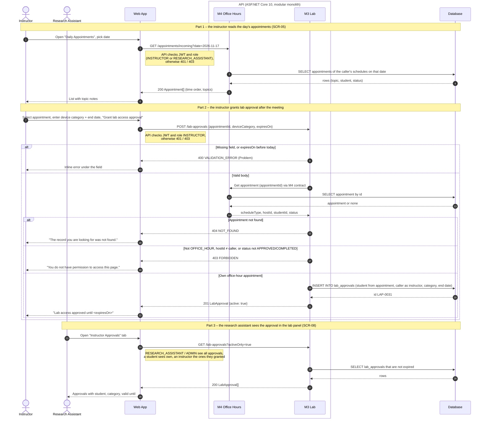

# Sequence Diagram – US-13 Lab access approval from an office-hour meeting

| Field | Value |
|---|---|
| Story | US-13 – As an instructor, I want to grant a student lab access approval from an office-hour meeting. ([#17](https://github.com/bookademic-team/Bookademic/issues/17)) |
| Use case | UC-1 Get lab access approval |
| Requirements | FR-M3-04, FR-M3-05, FR-M3-06 ([`srs.md`](../../sprint2/srs.md)) |
| Screens | SCR-05 Daily Appointments & Lab Approval (Instructor), SCR-08 Lab Management – Instructor Approvals tab (Research Assistant) |
| Endpoints (OpenAPI v0.2.3) | `GET /appointments/incoming` (listIncomingAppointments), `POST /lab-approvals` (grantLabApproval), `GET /lab-approvals` (listLabApprovals) |
| Issue | [#68](https://github.com/bookademic-team/Bookademic/issues/68) – sequence diagrams for owned stories |
| Author | Melih |

Participants use the C4 names of [`c4.md`](../c4.md): the **Web App** and **API** containers, the API components **M3 Lab** and **M4 Office Hours**, and the **Database** container. Tables are named as in [`database.md`](../database.md).

## Preconditions

- The student booked an office-hour appointment with the instructor (US-18); it is `APPROVED`, or `COMPLETED` if the meeting has already ended (appointments are completed automatically after their end time, [ADR-0003](../../adr/0003-notification-events-and-appointment-completion.md)). The instructor grants the approval after the meeting, so both statuses are accepted.
- The instructor is signed in; the Web App holds a JWT with role `INSTRUCTOR`.

## Diagram

## Steps and rules

| Step | What happens | Rule | FR |
|---|---|---|---|
| 1–6 | The instructor sees only appointments of their own schedules for the chosen date, in time order, with topics. | Only the caller's own hours | FR-M4-06 (US-19, used by US-13) |
| 7–10 | Body and role are checked before any data is read; an invalid body ends with `400`. | `appointmentId`, `deviceCategory`, `expiresOn` required; `expiresOn` not in the past; role `INSTRUCTOR` | FR-M3-04, FR-M3-05 |
| 11–14 | M3 does not read M4's tables. It asks M4 through its contract, as required by the module rules of ADR-0001. | Modules talk only through contract projects | ADR-0001 |
| 15–18 | An unknown appointment ends with `404`; it must be an `OFFICE_HOUR` appointment hosted by the caller. | Otherwise `404 NOT_FOUND` / `403 FORBIDDEN` | FR-M3-04 |
| 19–22 | The approval is stored with the student taken from the appointment and linked to it. | The approval is linked to the related appointment | FR-M3-04 |
| 23–28 | The research assistant's lab panel lists active approvals. | Visibility by role; `activeOnly` default `true` | FR-M3-06 |

## Afterwards: how the approval is used

The approval is not checked again in this flow. When the student later requests a device of the same category (US-06, see [`US-06.md`](US-06.md)), M2 Booking Core calls the `IEligibilityPolicy` provided by M3 Lab. The policy accepts the request only if a lab approval for the category is still active (`expiresOn` ≥ today) and a training authorisation exists. Otherwise the request fails with `403 LAB_APPROVAL_REQUIRED` or `403 TRAINING_REQUIRED` (FR-M2-03, FR-M3-05).

No notification is sent when an approval is granted: the `Notification.type` enum of OpenAPI v0.2.3 has no such event, and the backlog does not require one. The instructor who granted the approval is notified later, when the student completes the training (US-14, `TRAINING_GRANTED`).
