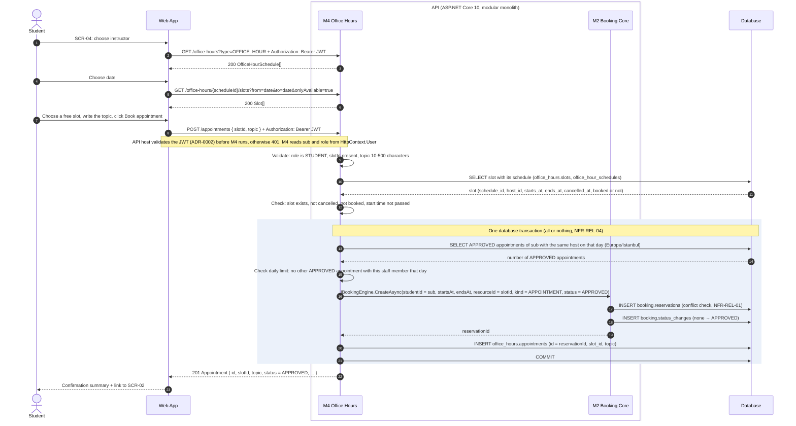
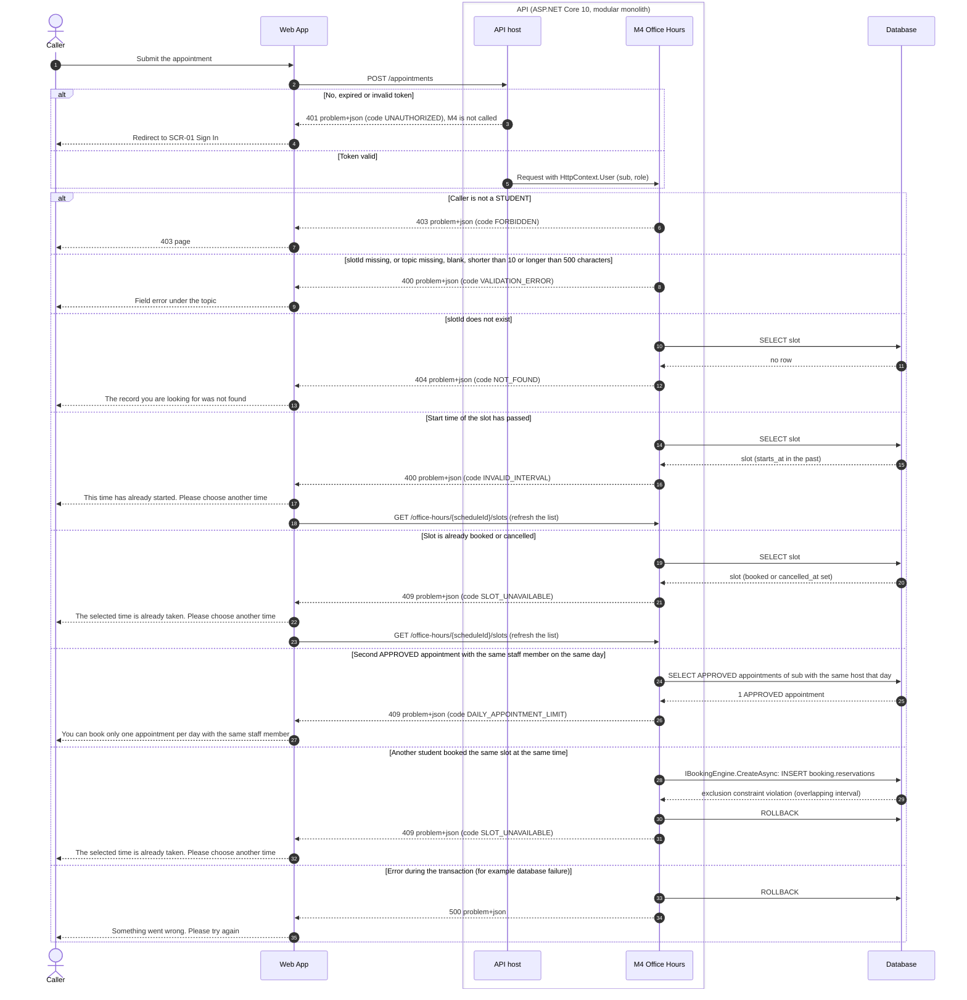

# Sequence Diagram – US-18 Book an Office Hour Appointment

| Field | Value |
|---|---|
| File | `docs/architecture/sequence/US-18.md` |
| Sprint | 2 (Requirements & Architecture) – deliverable 4 |
| Owner | Emir – Implementation & Integration Engineer |
| Reviewer | Mürsel – Lead Software Architect |
| Issue | #68 (US-18: #22) |
| Requirements | FR-M4-03, FR-M4-04, FR-M4-05 (SRS) |
| Use case | UC-1 Get lab access approval (steps 1–3) and UC-2 Complete device training (step 2): the booking is a step in both |
| Screens | SCR-04 Book Appointment → SCR-02 Calendar & My Appointments |
| Endpoint | `POST /appointments` (OpenAPI v0.2.3, tag `M4 Office Hours`), preceded by `GET /office-hours` and `GET /office-hours/{scheduleId}/slots` |
| Related | C4 components, UML state machine, Database schema, SRS, ADR-0002, ADR-0003, Test plan §2, §3.1, §3.2, NFR-REL-01 … NFR-REL-04 |

## 1. Story and acceptance criteria

> **US-18:** As a student, I want to book an appointment by writing my topic.
>
> **Acceptance criteria (FR-M4-03, FR-M4-04):** `STUDENT` only, otherwise 403; `slotId` required; topic required (10–500 characters), a missing, blank or too short/long topic returns `400 VALIDATION_ERROR`; a free slot becomes an `APPROVED` appointment (`201`), created through `IBookingEngine` as an M2 reservation of kind `APPOINTMENT`; a slot that is already taken → `409 SLOT_UNAVAILABLE`; a slot whose start time has passed → `400 INVALID_INTERVAL`; a second `APPROVED` appointment with the same staff member (instructor or research assistant) on the same day (Europe/Istanbul) → `409 DAILY_APPOINTMENT_LIMIT`; the new appointment appears in SCR-02 (`GET /appointments/my`, FR-M4-05).

| Participant | C4 element | Responsibility in this flow |
|---|---|---|
| Student | Person | Chooses the instructor, date and a free slot, writes the topic |
| Web App | Container (React + Vite + Ant Design) | SCR-04 form; sends the requests through `src/api/client.js` with the JWT; shows the message that matches the `code` of the error |
| API host | Container (ASP.NET Core 10) | JWT Bearer middleware validates the token before any module runs (ADR-0002) and puts the caller's id (`sub`) and role into `HttpContext.User`; answers `401` itself (FR-M1-04) |
| M4 Office Hours | Component | Owns `office_hour_schedules`, `slots`, `appointments`; validates the request, checks the slot and the daily limit, creates the appointment |
| M2 Booking Core | Component | Creates the reservation behind the appointment (kind `APPOINTMENT`, status `APPROVED`) through `IBookingEngine`, runs the conflict check and writes `status_changes` |
| Database | Container (PostgreSQL 17) | Schemas `booking`, `office_hours` |

## 2. Main flow

### Notes on the main flow

- Steps 1–6 (choosing the instructor, date and slot) are reads; they only fill SCR-04 and change nothing.
- The slot check (steps 10–12) gives a fast, clear error for the normal case. The real protection against two students booking the same slot at the same time is the conflict check of M2 and the PostgreSQL exclusion constraint (`EXCLUDE USING gist`, NFR-REL-01), so the booking is still checked inside the transaction (see Q2).
- The appointment is auto-approved when the slot is free (`APPROVED`), there is no instructor approval step. The appointment's `id` is the id of its underlying M2 reservation.
- The daily limit is counted per student and per staff member (instructor or research assistant), using the date in Europe/Istanbul. Only `APPROVED` appointments count; a `CANCELLED` one does not (FR-M4-04, SRS C5).
- After the change the student sees the appointment in SCR-02 (`GET /appointments/my`, FR-M4-05) and the instructor sees it in SCR-05 (`GET /appointments/incoming?date=`), with the topic.

## 3. Alternative and error flows

## 4. Test mapping

| Flow step | Test case (test plan) | NFR |
|---|---|---|
| Main flow, free slot | §2 (US-18 row): `201`, status `APPROVED`, 1 reservation of kind `APPOINTMENT` and 1 `status_changes` row, appointment visible in `GET /appointments/my` | NFR-REL-04 |
| Transaction and rollback | §2: failure injected after the reservation is created → no reservation, no appointment, no event (ADR-0003) | NFR-REL-04 |
| Authorization (`alt` 401/403) | §2: callers: no token, expired token, instructor, research assistant, secretary → 401 / 403 | NFR-REL-03 (error format) |
| Topic validation | §3.2: 9 / 10 / 500 / 501 characters, null and whitespace-only → 400 `VALIDATION_ERROR` | NFR-REL-03 |
| Slot not found | Unknown `slotId` → `404 NOT_FOUND` | NFR-REL-03 |
| Slot already taken | Second booking of the same slot → `409 SLOT_UNAVAILABLE`, nothing changed | NFR-REL-01 |
| Concurrent booking | 20 parallel requests for the same slot → exactly one `201` and 19 × `409 SLOT_UNAVAILABLE` | NFR-REL-01 |
| Slot already started | §3.1: `startsAt = now − 1 min` → `400 INVALID_INTERVAL`; `now + 1 min` → accepted | NFR-REL-02 |
| Daily limit | Second `APPROVED` appointment with the same staff member the same day → `409 DAILY_APPOINTMENT_LIMIT`; after cancelling the first one → `201`; same student with another staff member → `201` | – (FR-M4-04) |
| Date in Europe/Istanbul | Appointments at 23:30 and 00:30 are on different days (SRS C5; see Q6) | – (FR-M4-04) |
| Response time | Timing assertion for `POST /appointments` (see Q5). Only the SCR-04 load time is covered today | NFR-PERF-06 (SCR-04 only) |

## 5. Open points for review

| # | Point | Proposed answer | Owner |
|---|---|---|---|
| Q1 | How does M4 create the reservation in M2 inside "one transaction"? `IBookingEngine.CreateAsync` is assumed here | Same `NpgsqlConnection` and `DbTransaction` opened by M4, as proposed for US-20 (Q1) | Mürsel |
| Q2 | Does the exclusion constraint of NFR-REL-01 (`EXCLUDE USING gist`) also cover reservations of kind `APPOINTMENT`, so two students cannot book the same slot? (resourceId of such a reservation is the `Slot.id`, [database.md](../database.md)) | Yes: the same slot cannot be reserved twice, the loser gets `409 SLOT_UNAVAILABLE`. No extra unique index on `appointments.slot_id` is needed | Mürsel |
| Q3 | Does the instructor get an in-app notification (US-04) when a student books? | Not in the SRS for FR-M4-03; instructors see new appointments in SCR-05. If wanted, publish an event after `COMMIT` (ADR-0003) | Melih (PO) |
| Q4 | `Problem.code` is required, but `ErrorCode` has no value for unexpected server errors (500) | Add `INTERNAL_ERROR` to `ErrorCode` in the next contract version (same as US-20 Q4) | Mürsel |
| Q5 | `nfr.md` has no performance target for `POST /appointments` (NFR-PERF-02 covers `POST /reservations`) | Add a p95 < 200 ms item for `POST /appointments` | Mürsel |
| Q6 | The day boundary for the daily limit is not in test-plan §3.1a (only US-13 and US-20) | Add a test at 23:30 / 00:30 Istanbul time for US-18 | QA, Mürsel |
