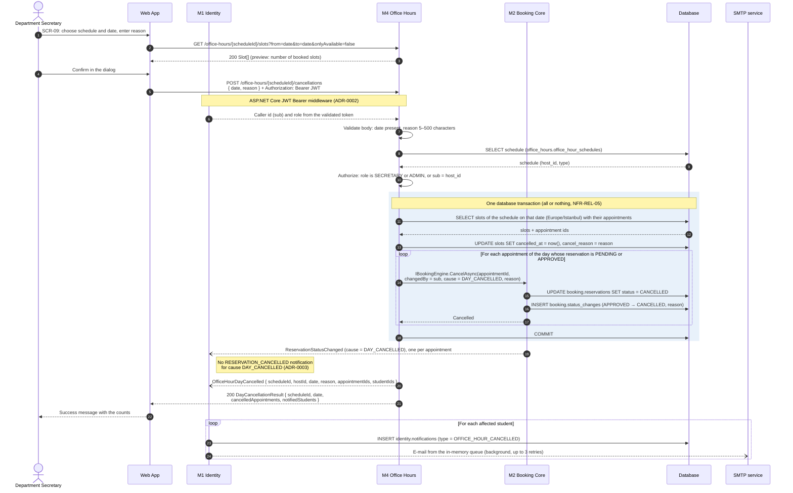
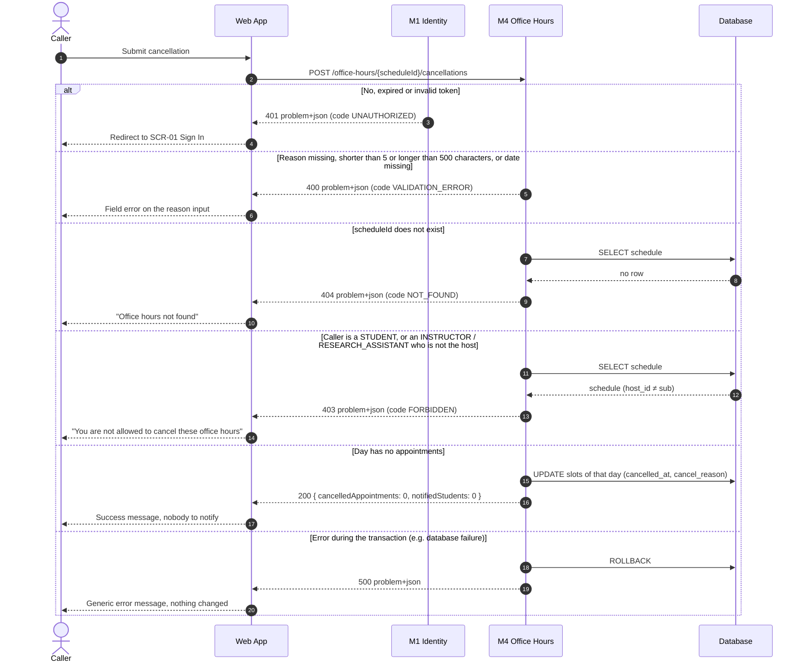

# Sequence Diagram – US-20 Cancel an Office Hour for a Specific Day

| Field | Value |
|---|---|
| File | `docs/architecture/sequence/US-20.md` |
| Sprint | 2 (Requirements & Architecture) – deliverable 4 |
| Owner | Mirac – Quality Assurance & Test Automation Engineer |
| Reviewer | Mürsel – Lead Software Architect |
| Issue | #68 (US-20: #24) |
| Use case | UC-4 Cancel office hours |
| Screens | SCR-09 Secretary & Admin Management → SCR-02 Calendar & My Appointments, CMP-01 Notification Center |
| Endpoint | `POST /office-hours/{scheduleId}/cancellations` (OpenAPI v0.2.3, tag `M4 Office Hours`) |
| Related | [C4 components](../c4.md#3-level-3--components-of-the-api), [UML state machine](../uml.md), [Database schema](../database.md), [ADR-0002](../../adr/0002-authentication-with-jwt.md), [ADR-0003](../../adr/0003-notification-events-and-appointment-completion.md), [Test plan §3.4](../../test-plan.md) |

## 1. Story and acceptance criteria

> **US-20:** As a department secretary, I want to cancel an office hour for a specific day.
>
> **Acceptance criteria:** `SECRETARY`/`ADMIN` or the owner of the hours only; reason required; all appointments of that day become `CANCELLED`; affected students receive an in-app notification (US-04).

| Participant | C4 element | Responsibility in this flow |
|---|---|---|
| Department Secretary | Person | Chooses the schedule and date, writes the reason (an `ADMIN` or the schedule host can do the same) |
| Web App | Container (React + Vite + Ant Design) | SCR-09 form; sends the request through `src/api/client.js` with the JWT |
| M1 Identity | Component | Validates the JWT and provides the caller's id and role; stores notifications; sends e-mails |
| M4 Office Hours | Component | Owns `office_hour_schedules`, `slots`, `appointments`; checks the host rule; marks the day's slots as cancelled |
| M2 Booking Core | Component | Changes each appointment's reservation to `CANCELLED` through `IBookingEngine` and writes `status_changes` |
| Database | Container (PostgreSQL 17) | Schemas `identity`, `booking`, `office_hours` |
| SMTP service | External system (Mailpit in development) | Delivers the e-mails (US-23) |

## 2. Main flow

**Notes on the main flow**

- Steps 2–3 (preview) are optional for the API; they only fill the confirmation dialog of SCR-09 (`ui-screens.md`).
- Events are published **after** the transaction commits (ADR-0003), so a rolled-back cancellation never notifies anyone. The response does not wait for notifications or e-mail (NFR-PERF-04, NFR-REL-06).
- Appointments that are already `CANCELLED`, `REJECTED` or `COMPLETED` are skipped and not counted in `cancelledAppointments`.
- After the change the student sees the appointment in the cancelled section of SCR-02 and a new item in CMP-01; the slots are no longer offered because `cancelled_at` is set.

## 3. Alternative and error flows

## 4. Test mapping

| Flow step | Test case (test plan) | NFR |
|---|---|---|
| Main flow, 3 appointments of 3 students | §3.4: 3 × `CANCELLED`, 3 × `OFFICE_HOUR_CANCELLED`, 0 × `RESERVATION_CANCELLED` | NFR-REL-04 |
| Transaction and rollback | Failure injected after the first appointment → nothing changed | NFR-REL-05 |
| Authorization (`alt` 401/403) | §3.4 callers; enumerated 401 test | NFR-SEC-01, NFR-SEC-03 |
| Reason validation | §3.4: 4 / 5 / 500 / 501 characters | NFR-REL-03 |
| Date in Europe/Istanbul | §3.1a: 23:59 / 00:00 / 02:59 | NFR-REL-02 |
| Response time with 12 appointments | Timing assertion < 500 ms | NFR-PERF-05 |
| E-mail with Mailpit stopped | Request still 200, notification rows exist | NFR-REL-06 |

## 5. Open points for review

| # | Point | Proposed answer | Owner |
|---|---|---|---|
| Q1 | M4 and M2 use separate `DbContext`s. How is the "one transaction" in the main flow implemented? | Both contexts share one `NpgsqlConnection` and one `DbTransaction` opened by M4 (same database); alternatively `IBookingEngine` offers a batch `CancelManyAsync` that runs in M2's transaction while M4 updates its slots in the same transaction scope | Mürsel |
| Q2 | Can a date in the past, or today after the hours have started, be cancelled? | Past dates → `400 INVALID_INTERVAL`, consistent with the v0.2.3 past-start rule; today is allowed and cancels only appointments that have not started yet | Melih (PO), Mürsel (contract) |
| Q3 | What happens if the same day is cancelled twice? | Second call returns 200 with `cancelledAppointments: 0` (idempotent) | Mürsel |
| Q4 | `Problem.code` is required, but the `ErrorCode` enum has no value for unexpected server errors (500) | Add `INTERNAL_ERROR` to `ErrorCode` in the next contract version | Mürsel |
