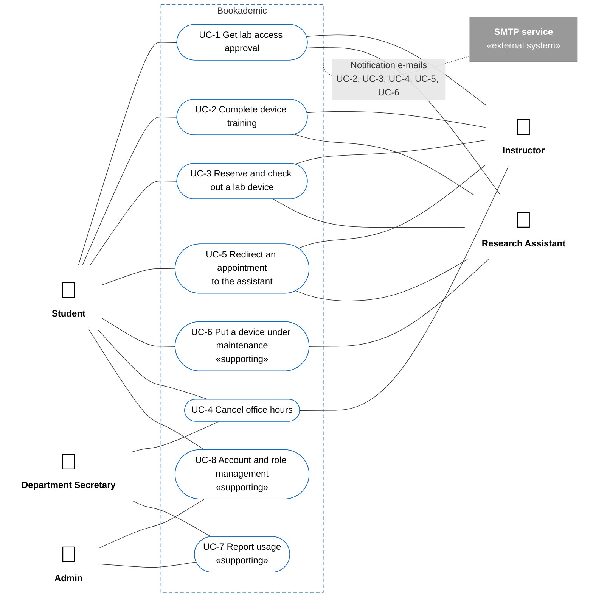
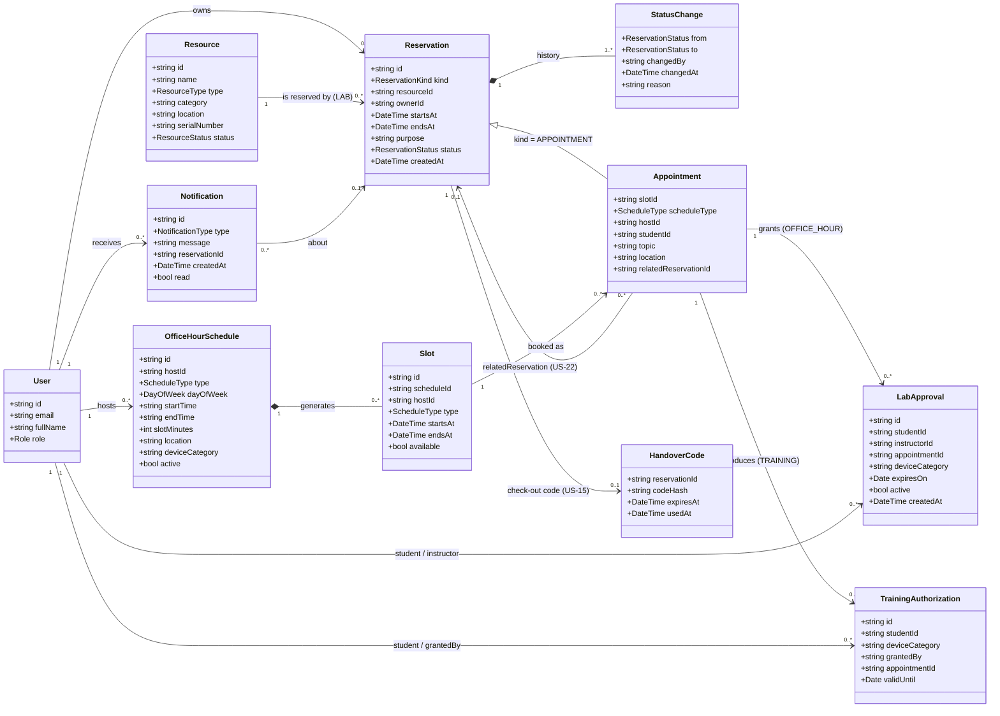
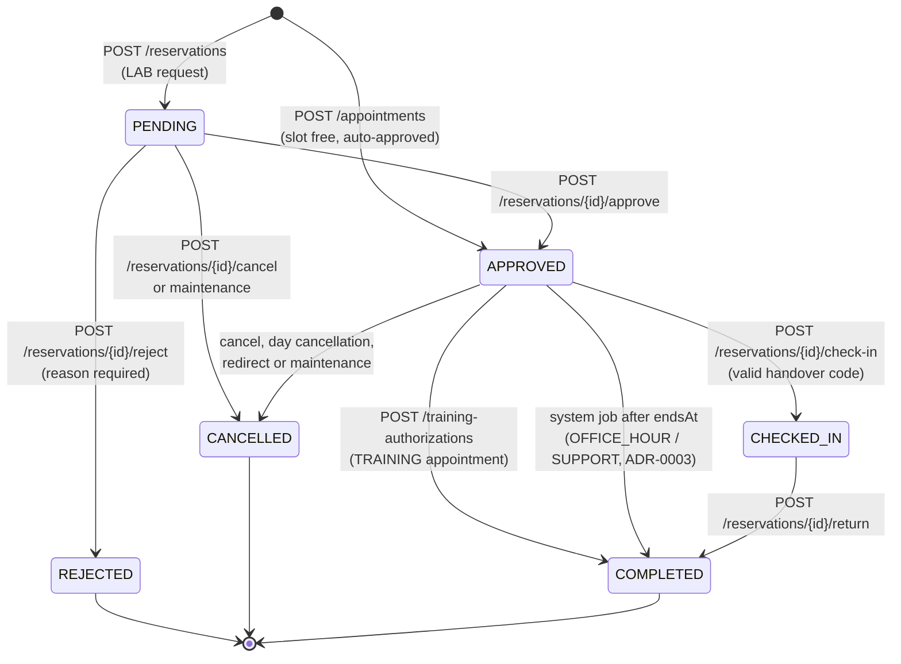

# Bookademic – UML Diagrams

| Field | Value |
|---|---|
| File | `docs/architecture/uml.md` |
| Sprint | 2 (Requirements & Architecture) |
| Owner | Mürsel – Lead Software Architect |
| Reviewer | Emir (class attributes must be usable on the screens in `docs/ui-screens.md`) |
| Related | [C4 model](c4.md), [Database](database.md), [OpenAPI v0.2.3](../api/openapi.yaml), [Vision use cases](../sprint1/vision.md), [Sequences](sequence/) |

This document contains three UML views of Bookademic:

1. **Use case diagram:** who does what with the system (UC-1 … UC-8 from `vision.md`).
2. **Domain class diagram:** the entities, their attributes, relationships and multiplicities. Names and attributes are taken from the OpenAPI schemas.
3. **State machine:** the lifecycle of a `Reservation`, with the endpoint that triggers each transition.

Sequence diagrams are in [`sequence/`](sequence/) (one file per user story, owned by each story owner).

---

## 1. Use case diagram

Solid lines are associations between an actor and a use case; primary actors are on the left, supporting actors and the external system on the right. The dashed line to the SMTP service marks the use cases that send e-mail notifications (US-23); in-app notifications (US-04) are created in the same use cases (see the table).

| Use case | Actors | Stories | Notifications |
|---|---|---|---|
| UC-1 Get lab access approval | Student, Instructor, Research Assistant | US-18, US-13, US-19 | – |
| UC-2 Complete device training | Student, Research Assistant, Instructor | US-17, US-18, US-14 | `TRAINING_GRANTED` to the instructor |
| UC-3 Reserve and check out a lab device | Student, Research Assistant, Instructor | US-12, US-06, US-08, US-15 | `RESERVATION_APPROVED` / `RESERVATION_REJECTED` |
| UC-4 Cancel office hours | Department Secretary, Instructor, Student | US-20, US-04 | `OFFICE_HOUR_CANCELLED` |
| UC-5 Redirect an appointment to the assistant | Instructor, Research Assistant, Student | US-21 | `APPOINTMENT_REDIRECTED` |
| UC-6 Put a device under maintenance *(supporting)* | Research Assistant, Student | US-16 | `RESERVATION_CANCELLED` |
| UC-7 Report usage *(supporting)* | Department Secretary, Admin | US-05 | – |
| UC-8 Account and role management *(supporting)* | Student, Admin | US-01, US-02, US-03 | – |

The main journey runs through UC-1 → UC-2 → UC-3: a student first gets an approval from an instructor, then a training authorisation, and only then can reserve a device.

---

## 2. Domain class diagram

### 2.1 Enumerations

Values are exactly the OpenAPI enums (upper case).

| Enum | Values |
|---|---|
| `Role` | STUDENT, INSTRUCTOR, RESEARCH_ASSISTANT, SECRETARY, ADMIN |
| `ReservationStatus` | PENDING, APPROVED, REJECTED, CANCELLED, CHECKED_IN, COMPLETED |
| `ReservationKind` | LAB, APPOINTMENT |
| `ResourceType` | DEVICE, ROOM |
| `ResourceStatus` | AVAILABLE, MAINTENANCE |
| `ScheduleType` | OFFICE_HOUR, SUPPORT, TRAINING |
| `NotificationType` | RESERVATION_APPROVED, RESERVATION_REJECTED, RESERVATION_CANCELLED, OFFICE_HOUR_CANCELLED, APPOINTMENT_REDIRECTED, TRAINING_GRANTED |
| `DayOfWeek` | MONDAY … SUNDAY |

### 2.2 Modelling decisions

| Decision | Why |
|---|---|
| **Every `Appointment` is a `Reservation`** (generalisation). It inherits `id`, `status`, `startsAt`, `endsAt` and is created through `IBookingEngine`. | One conflict rule and one state machine for lab devices and staff time (ADR-0001). The appointment id is the reservation id, as in OpenAPI. |
| `Reservation.resourceId` is the **bookable key**: a `Resource.id` for `LAB` reservations and the `Slot.id` for `APPOINTMENT` reservations. | The overlap constraint in the database works on (key, time range) for both kinds without a second mechanism. See [database.md](database.md). |
| `StatusChange` is a **composition** of `Reservation`. | A status history has no meaning without its reservation; it is deleted with it and never edited. |
| `Slot` is a **composition** of `OfficeHourSchedule`. | Slots are generated from the schedule and disappear when the schedule is deactivated. |
| `LabApproval` and `TrainingAuthorization` **reference an `Appointment`**. | US-13 and US-14: an approval comes out of an office-hour meeting and an authorisation out of a training session; the reference proves it. |
| Approval and authorisation are **per device category**, not per device. | Matches the acceptance criteria of US-13 and US-14 and the `deviceCategory` fields in OpenAPI. |

### 2.3 Module ownership

| Module (C4 component) | Classes |
|---|---|
| M1 Identity | `User`, `Notification` |
| M2 Booking Core | `Reservation`, `StatusChange` |
| M3 Lab | `Resource`, `LabApproval`, `TrainingAuthorization`, `HandoverCode` |
| M4 Office Hours | `OfficeHourSchedule`, `Slot`, `Appointment` |

---

## 3. State machine: Reservation lifecycle

The six states are exactly the `ReservationStatus` enum. **Active** states are `PENDING`, `APPROVED` and `CHECKED_IN`: only reservations in these states take part in the overlap check, so a cancelled or rejected interval can be booked again immediately.

### 3.1 Transitions

| From | To | Trigger (endpoint) | Who | Guard | Error if not allowed |
|---|---|---|---|---|---|
| – | PENDING | `POST /reservations` | Student | Valid interval; resource available; active lab approval and training for the category; no overlap | 400 `INVALID_INTERVAL`, 403 `LAB_APPROVAL_REQUIRED` / `TRAINING_REQUIRED`, 409 `RESOURCE_IN_MAINTENANCE` / `SLOT_UNAVAILABLE` |
| – | APPROVED | `POST /appointments` | Student | Slot exists, free and not started; topic 10–500 characters; one appointment per staff member per day | 400 `VALIDATION_ERROR`, 400 `INVALID_INTERVAL` (slot already started), 404 `NOT_FOUND`, 409 `SLOT_UNAVAILABLE` / `DAILY_APPOINTMENT_LIMIT` |
| PENDING | APPROVED | `POST /reservations/{id}/approve` | Research Assistant, Admin | – | 409 `INVALID_STATE_TRANSITION` |
| PENDING | REJECTED | `POST /reservations/{id}/reject` | Research Assistant, Admin | Reason at least 5 characters | 400, 409 `INVALID_STATE_TRANSITION` |
| PENDING, APPROVED | CANCELLED | `POST /reservations/{id}/cancel` | Owner | Before `startsAt` | 409 `CANCELLATION_WINDOW_PASSED` |
| APPROVED | CANCELLED | `POST /office-hours/{id}/cancellations` | Secretary, Admin, host | Appointment on the cancelled day | – |
| APPROVED | CANCELLED | `POST /appointments/{id}/redirect` | Instructor | Free target support slot (a new appointment is created) | 409 `NO_AVAILABLE_SLOT` |
| PENDING, APPROVED | CANCELLED | `POST /resources/{id}/maintenance` | Research Assistant, Admin | Future reservations of that resource | – |
| APPROVED | CHECKED_IN | `POST /reservations/{id}/check-in` | Research Assistant | Valid 6-digit handover code (US-15) | 400 `INVALID_HANDOVER_CODE`, 409 `INVALID_STATE_TRANSITION` |
| APPROVED | COMPLETED | `POST /training-authorizations` | Research Assistant | Appointment is a `TRAINING` appointment | 400 `NOT_A_TRAINING_APPOINTMENT`, 409 `TRAINING_ALREADY_GRANTED` |
| APPROVED | COMPLETED | – (background job every 5 min, ADR-0003) | System job; recorded with `changedBy` = host | `OFFICE_HOUR` or `SUPPORT` appointment whose `endsAt` has passed | – (no request, no notification) |
| CHECKED_IN | COMPLETED | `POST /reservations/{id}/return` | Research Assistant | – | 409 `INVALID_STATE_TRANSITION` |

Every transition writes a `StatusChange` row (who, when, from, to, reason) and publishes an event that M1 Identity turns into a notification where the use case table above lists one.

**Appointment completion:** OpenAPI v0.2.3 has no endpoint to complete an appointment. [ADR-0003](../adr/0003-notification-events-and-appointment-completion.md) decides that a background job moves `APPROVED` `OFFICE_HOUR` and `SUPPORT` appointments to `COMPLETED` automatically after `endsAt` (row "system job" above). `changedBy` is the host, because `status_changes.changed_by` must be a real user id and the role enum has no system user; the history row's `reason` says "Completed automatically after the end time". `TRAINING` appointments are completed only by `POST /training-authorizations`. No contract change is needed.
