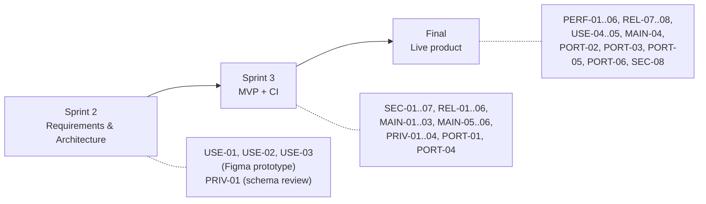

# Bookademic – Non-Functional Requirements and Quality Measures

| Field | Value |
|---|---|
| File | `docs/sprint2/nfr.md` |
| Sprint | 2 (Requirements & Architecture) – course deliverable 2 |
| Owner | Mirac – Quality Assurance & Test Automation Engineer |
| Reviewer | Melih – Product Owner (every NFR is linked to a US/FR and has a measurable target) |
| Issue | #66 |
| Related | [SRS](srs.md) (#60), [OpenAPI v0.2.3](../api/openapi.yaml), [ADR-0001](../adr/0001-tech-stack.md), [ADR-0002](../adr/0002-authentication-with-jwt.md), [ADR-0003](../adr/0003-notification-events-and-appointment-completion.md), [Database schema](../architecture/database.md), [Test plan](../test-plan.md) |

## 1. Purpose and rules

This document lists the quality attributes Bookademic must meet, in addition to the functional requirements of the SRS. It is the input for the test plan: every NFR below is verified by at least one test or check listed in [test-plan.md §6](../test-plan.md#6-nfr-verification-matrix).

Rules for every NFR in this document:

1. **ID** follows `NFR-<category>-<no>` (Sprint 2 planning, decision D5).
2. **Measurable.** Every NFR has a metric, a numeric or yes/no target and a measurement method. Words such as "fast", "secure" or "user-friendly" are not used without a number.
3. **Traceable.** Every NFR names the related user stories (`US-xx`), use cases (`UC-x`) and functional requirements (`FR-<module>-<no>` from the [SRS](srs.md)). Cross-cutting NFRs that apply to all functional requirements show `–` in the *Related FR* column.
4. **Vocabulary.** Module, entity, enum, actor and container names are taken from OpenAPI v0.2.3, ADR-0001 and the C4 model without change.
5. **Priority** uses the backlog's MoSCoW scale. A *Must* NFR blocks the release if it fails; a *Should* NFR is recorded as a known defect.

### Categories

| Code | Category | Main question |
|---|---|---|
| PERF | Performance | How fast does the API respond under the expected data volume? |
| SEC | Security | Who can do what, and how are credentials and codes protected? |
| REL | Reliability | Does the system keep data correct under concurrency, failures and restarts? |
| USE | Usability | Can the five actors finish their main tasks without help? |
| MAIN | Maintainability | Can the team change the code safely (tests, boundaries, static analysis)? |
| PORT | Portability & installation | Does the product start with one command on every team machine? |
| PRIV | Privacy (KVKK) | Is only the necessary personal data collected and protected? |

### Measurement conditions (apply to every PERF item)

| Item | Value |
|---|---|
| Environment | Local `docker compose up` stack (`web`, `api`, `db`, `mailpit`) on a developer laptop; the `api` built in `Release` configuration |
| Data volume | Seed script with **500 records** per measured table (500 `resources`, 500 `reservations`, 500 `slots`), synthetic data only (NFR-PRIV-03) |
| Load profile | k6 (`grafana/k6` container): 30 s warm-up, then 2 min at **20 virtual users**, think time 1 s |
| Metric | p95 of server response time per endpoint, from the k6 `http_req_duration` metric; a run fails if any threshold is broken |
| Error budget | `http_req_failed` < 1% during the run |

---

## 2. Performance (PERF)

| ID | Requirement | Metric | Target | Measurement method | Related US / UC | Related FR | Priority |
|---|---|---|---|---|---|---|---|
| NFR-PERF-01 | Catalogue search with combined filters (`type`, `category`, availability interval) responds within the target time | p95 of `GET /resources` | **< 200 ms** with 500 resources and 500 reservations | k6 script `perf/catalog.js` under the conditions above | US-12, US-11 / UC-3 | FR-M3-03 | Must |
| NFR-PERF-02 | Creating a lab reservation, including the eligibility and conflict checks of M2 Booking Core, responds within the target time | p95 of `POST /reservations` (201 and 409 responses) | **< 200 ms** with 500 existing reservations | k6 script `perf/reservation.js`; half the requests hit a free interval, half a taken one | US-06, US-07 / UC-3 | FR-M2-01 … FR-M2-06 | Must |
| NFR-PERF-03 | The user's own read views respond within the target time | p95 of `GET /me/calendar`, `GET /notifications?unreadOnly=true`, `GET /appointments/incoming` | **< 200 ms** each, with 500 records in the underlying table | k6 script `perf/read-views.js` | US-10, US-04, US-19 / UC-1, UC-4 | FR-M2-11, FR-M1-08, FR-M4-06 | Should |
| NFR-PERF-04 | A request that triggers a notification never waits for the SMTP service (ADR-0003) | p95 of `POST /reservations/{id}/approve` with the `mailpit` container **stopped** | **< 200 ms** and 0% failed requests | k6 run with `docker compose stop mailpit` | US-23, US-04, US-08 / UC-3 | FR-M1-10, FR-M1-07, FR-M2-07 | Must |
| NFR-PERF-05 | Cancelling an office-hour day with many appointments finishes within the target time | Response time of `POST /office-hours/{scheduleId}/cancellations` for a day with 12 appointments | **< 500 ms** (p95 of 20 runs) | Integration test with timing assertion (Testcontainers) | US-20 / UC-4 | FR-M4-07 | Should |
| NFR-PERF-06 | The main screens of the Web App load quickly on the desktop | Lighthouse *Performance* score (desktop preset) on SCR-01, SCR-04, SCR-07 | **≥ 80** | Lighthouse CI against the production build served by the `web` container | US-02, US-18, US-12 | FR-M1-03, FR-M4-03, FR-M3-03 | Could |

## 3. Security (SEC)

| ID | Requirement | Metric | Target | Measurement method | Related US / UC | Related FR | Priority |
|---|---|---|---|---|---|---|---|
| NFR-SEC-01 | Every endpoint except `POST /auth/register` and `POST /auth/login` requires a valid bearer token (fallback policy, ADR-0002) | Share of the 35 OpenAPI operations that return `401 UNAUTHORIZED` without a token | **100%** (33 of 33 protected operations) | Integration test that enumerates all operations from `openapi.yaml` and calls each without a token | US-02 / UC-8 | FR-M1-04 | Must |
| NFR-SEC-02 | Expired, malformed, wrongly signed and wrong-audience tokens are rejected | Response to each invalid token type | **401 `UNAUTHORIZED`** for all 5 cases; token lifetime 60 min, clock skew 1 min | Integration tests with crafted tokens (ADR-0002 §6) | US-02 | FR-M1-03, FR-M1-04 | Must |
| NFR-SEC-03 | Role-based and ownership-based access is enforced by the API, not only hidden in the Web App | Number of role × operation and owner × record combinations that return the wrong status | **0** wrong results; wrong role or someone else's record → **403 `FORBIDDEN`** | Data-driven integration test: 5 roles (`STUDENT`, `INSTRUCTOR`, `RESEARCH_ASSISTANT`, `SECRETARY`, `ADMIN`) × every protected operation, plus "someone else's reservation/appointment" cases for US-09, US-20, US-21 | US-02, US-03, US-08, US-09, US-20, US-21 / UC-4, UC-5, UC-8 | FR-M1-04, FR-M1-05, FR-M2-07, FR-M2-10, FR-M4-07, FR-M4-08 | Must |
| NFR-SEC-04 | Passwords are stored only as PBKDF2 hashes (`PasswordHasher`) and never appear in logs or responses | Occurrences of a known test password in `identity.users`, API logs and any response body | **0** | Integration test: register with a marker password, then search the table, the captured log output and the responses | US-01, US-02 | FR-M1-01, FR-M1-03 | Must |
| NFR-SEC-05 | Login does not reveal which accounts exist | Difference between the responses for an unknown e-mail and for a wrong password | **Identical** status (401) and body | Integration test comparing both responses | US-02 | FR-M1-03 | Must |
| NFR-SEC-06 | The US-15 handover code cannot be guessed or reused | Code length, storage, reuse and wrong-attempt behaviour | 6 digits; stored only as a hash; **second use rejected**; expired code → `400 INVALID_HANDOVER_CODE`; after **5 wrong attempts** the code is invalidated and a new one must be issued | Unit tests of the code service + integration tests on `POST /reservations/{id}/check-in`. The 5-attempt limit is proposed here and must be added to the OpenAPI description by Mürsel (D8) before Sprint 3 | US-15 / UC-3 | FR-M3-09, FR-M3-10 | Should |
| NFR-SEC-07 | No known vulnerabilities or secrets in the code base | SonarQube *Vulnerabilities* and *Security Hotspots (unreviewed)* on `develop`; secrets committed to Git | **0 Blocker/Critical** vulnerabilities, **0** unreviewed hotspots, **0** committed secrets (no real `.env`, `Jwt__SigningKey` only as a placeholder) | SonarQube quality gate in CI (EN-04); `.gitignore` check in PR review | All | – | Must |
| NFR-SEC-08 | Repeated failed logins are throttled | Response to the 6th login attempt within 1 minute from the same IP | **429** with problem details | Integration test. Depends on the `429` response being added to the contract (ADR-0002 follow-up, owner Mürsel); verified only after that | US-02 | FR-M1-03 | Could |

## 4. Reliability (REL)

| ID | Requirement | Metric | Target | Measurement method | Related US / UC | Related FR | Priority |
|---|---|---|---|---|---|---|---|
| NFR-REL-01 | No double booking, even for simultaneous requests (PostgreSQL `EXCLUDE USING gist` + M2 Booking Core conflict engine) | Number of overlapping active (`PENDING`, `APPROVED`, `CHECKED_IN`) reservations for the same `resource_id` after a concurrency test | **0**; of 20 parallel `POST /reservations` for the same interval exactly **1 × 201** and **19 × 409 `SLOT_UNAVAILABLE`** | Integration test with Testcontainers (PostgreSQL 17) and parallel tasks; followed by an SQL check for overlapping rows | US-06, US-07, US-18 / UC-3 | FR-M2-04, FR-M4-04 | Must |
| NFR-REL-02 | Interval rules are applied consistently at the boundaries | Result of the boundary cases in [test-plan.md §3.1](../test-plan.md) | **100% pass**: back-to-back allowed; partial overlap, nesting and identical intervals → 409; `endsAt ≤ startsAt` or `startsAt` in the past → `400 INVALID_INTERVAL` | Unit tests of the conflict engine + integration tests | US-06, US-07, US-17, US-18 | FR-M2-01, FR-M2-06, FR-M4-02, FR-M4-04 | Must |
| NFR-REL-03 | Every error response follows RFC 9457 | Share of 4xx/5xx responses with `Content-Type: application/problem+json` and the `title`, `status`, `code` fields | **100%** of error responses in the integration and contract test runs | Shared assertion helper used by all integration tests; contract test against `openapi.yaml` | All | – | Must |
| NFR-REL-04 | Every status transition is atomic and recorded | Transitions without exactly one `status_changes` row; events published for rolled-back transactions | **0** and **0** | Integration tests: each allowed transition writes one row; a forced rollback publishes no event (ADR-0003 §5) | US-08, US-09, US-15 / UC-3 | FR-M2-08, FR-M2-09 | Must |
| NFR-REL-05 | Cancelling an office-hour day is all-or-nothing | Days left with some appointments `CANCELLED` and others still `APPROVED` after a failure in the middle of the operation | **0** | Integration test that injects a failure after the first appointment and checks that no appointment and no slot changed | US-20 / UC-4 | FR-M4-07 | Must |
| NFR-REL-06 | An SMTP failure does not fail the user's operation | Result of a status change while `mailpit` is down | Request returns **200/201**, the `notifications` row exists, the e-mail is retried **3 times** (5 s, 30 s, 2 min) and the failure is logged | Integration test with Mailpit stopped; log assertion | US-23, US-04 | FR-M1-10 | Must |
| NFR-REL-07 | Data survives a restart, and the stack recovers on its own | Data after `docker compose down` + `up` (without `-v`); time until `api` answers again | **All rows kept**; `api` healthy **≤ 60 s** after `docker compose up` (cached images) | Scripted restart check before each release (input: Mehmet, deployment #71) | EN-03 | – | Must |
| NFR-REL-08 | The main user journey runs without failure | Consecutive green runs of the Playwright main-journey test (SCR-01 → SCR-04 → SCR-05 → SCR-06 → SCR-07 → SCR-08); 5xx responses during the run | **3 of 3** runs green, **0** flaky retries, **0** 5xx | Playwright in CI against the compose stack (from Sprint 3) | UC-1, UC-2, UC-3 | – | Must |

## 5. Usability (USE)

| ID | Requirement | Metric | Target | Measurement method | Related US / UC | Related FR | Priority |
|---|---|---|---|---|---|---|---|
| NFR-USE-01 | A first-time student can book an office-hour appointment without help | Task success rate and time for "sign in → find a free slot → book with a topic" | **≥ 4 of 5** test users succeed, median time **≤ 2 min**, no help asked | Moderated usability test with 5 students on the Figma prototype (Sprint 2) and on the MVP (Sprint 3); observer notes | US-18, US-02 / UC-1 | FR-M4-03, FR-M4-04 | Should |
| NFR-USE-02 | A research assistant can approve a pending lab request quickly | Number of clicks from the lab panel (SCR-08) to an approved request | **≤ 3 clicks** | Walkthrough on the Figma prototype and the MVP | US-08 / UC-3 | FR-M2-07 | Should |
| NFR-USE-03 | Every error is shown as an understandable message, never as a raw code or stack trace | Share of error states (400, 403, 404, 409, empty list, network error) with a user message from [ui-screens.md §8](../ui-screens.md) | **100%** | Checklist review of the Figma screens; Playwright tests that trigger 403, 409 and an empty list | US-06, US-09, US-12, US-18 | – | Must |
| NFR-USE-04 | The Web App is accessible on the main screens | Lighthouse *Accessibility* score (desktop) on SCR-01, SCR-04, SCR-07; keyboard-only completion of the booking form | **≥ 90**; booking form fully usable with the keyboard | Lighthouse CI + manual keyboard check | US-02, US-18, US-12 | – | Should |
| NFR-USE-05 | Overall perceived usability | System Usability Scale (SUS) score from the usability test participants | **≥ 68** (industry average) | SUS questionnaire after NFR-USE-01 sessions | UC-1, UC-3 | – | Could |

## 6. Maintainability (MAIN)

| ID | Requirement | Metric | Target | Measurement method | Related US / UC | Related FR | Priority |
|---|---|---|---|---|---|---|---|
| NFR-MAIN-01 | The M2 Booking Core conflict engine and access rules are covered by unit tests | Line coverage of `Bookademic.Booking.Core` | **≥ 50%** (course requirement); team target **80%** | coverlet (Cobertura) in CI; the build fails below 50% (`coverlet.msbuild /p:Threshold=50`) | US-07 | FR-M2-04, FR-M2-06 | Must |
| NFR-MAIN-02 | The backend as a whole is covered by automated tests | Line coverage of all backend projects | **≥ 50%**, CI fails below | coverlet + ReportGenerator in the GitHub Actions pipeline (EN-04) | EN-04 | – | Must |
| NFR-MAIN-03 | Module boundaries of the modular monolith are kept | ArchUnitNET rule violations (a module referencing another module's internal project; M3/M4 changing reservations without `IBookingEngine`) | **0** | `Bookademic.ArchitectureTests` in CI | US-07, all | – | Must |
| NFR-MAIN-04 | Code quality stays within the agreed limits | SonarQube on new code: maintainability rating, duplicated lines, technical-debt ratio | Rating **A**, duplication **< 3%**, debt ratio **< 5%** | SonarQube quality gate in CI; report for the final submission | All | – | Should |
| NFR-MAIN-05 | Code follows one style | `dotnet format --verify-no-changes` and ESLint errors | **0** | CI step on every pull request | All | – | Should |
| NFR-MAIN-06 | The implementation matches the API contract | Spectral lint errors on `openapi.yaml`; responses in integration tests that do not validate against the contract schema | **0** and **0** | Spectral in CI; response validation helper in integration tests | EN-02, all | – | Must |

## 7. Portability and installation (PORT)

| ID | Requirement | Metric | Target | Measurement method | Related US / UC | Related FR | Priority |
|---|---|---|---|---|---|---|---|
| NFR-PORT-01 | The product starts with one command from a fresh clone | Steps after `git clone` until the Web App opens; services healthy | **2 steps** (`cp .env.example .env`, `docker compose up`); all 4 services (`db`, `api`, `web`, `mailpit`) up and `db` healthy | Release checklist run on a clean machine (input: Mehmet, deployment #71) | EN-03 | – | Must |
| NFR-PORT-02 | Start-up time is acceptable | Time from `docker compose up` until `api` answers | **≤ 5 min** first build, **≤ 60 s** with cached images | Timed run in the release checklist | EN-03 | – | Should |
| NFR-PORT-03 | The only host requirement is Docker | Tools that must be installed on the host besides Docker Engine and Compose v2 | **0**; verified on Windows, macOS and Linux team machines | Release checklist; each team member confirms once per sprint | EN-03 | – | Must |
| NFR-PORT-04 | All configuration comes from environment variables | Variables used by `docker-compose.yml` that are missing from `.env.example`; secrets baked into images | **0** and **0** | PR review checklist; comparison script in CI | EN-03 | – | Must |
| NFR-PORT-05 | The Web App works in the supported desktop browsers | Main-journey Playwright test result per browser at 1280 × 720 | **Pass** in Chromium, Firefox and WebKit (latest stable) | Playwright projects for the three engines | UC-1, UC-3 | – | Should |
| NFR-PORT-06 | Every dependency is compatible with the MIT licence | Direct and transitive dependencies with an incompatible licence | **0** | `dotnet-project-licenses` and `license-checker` reports before each release (ADR-0001 follow-up) | – | – | Should |

## 8. Privacy – KVKK (PRIV)

| ID | Requirement | Metric | Target | Measurement method | Related US / UC | Related FR | Priority |
|---|---|---|---|---|---|---|---|
| NFR-PRIV-01 | Only the personal data the system needs is stored (data minimisation) | Personal-data columns in the database beyond name, school e-mail and role | **0** (no student number, phone, address) | Schema review against [database.md §5](../architecture/database.md); test that `User` responses contain only `id`, `email`, `fullName`, `role` | US-01, US-03 / UC-8 | FR-M1-01 | Must |
| NFR-PRIV-02 | Users see only their own bookings and notifications | Records of other users returned by `GET /me/calendar`, `GET /notifications`, `GET /appointments/my` | **0** | Integration tests with two students | US-10, US-04, US-18 | FR-M2-11, FR-M1-08, FR-M4-05 | Must |
| NFR-PRIV-03 | Test and demo data are synthetic | Real person data in seed scripts, fixtures and screenshots | **0** | PR review checklist; seed data generated by script | All | – | Must |
| NFR-PRIV-04 | Tokens and logs carry minimal personal data | JWT claims beyond `sub`, `email`, `name`, `role`, `jti`, `iat`, `exp`; passwords, handover codes or tokens written to logs | **0** and **0** | Unit test that decodes an issued token; log assertion in integration tests | US-02, US-15 | FR-M1-03, FR-M3-09 | Must |

---

## 9. Summary

| Category | Must | Should | Could | Total |
|---|---|---|---|---|
| PERF | 3 | 2 | 1 | 6 |
| SEC | 6 | 1 | 1 | 8 |
| REL | 8 | 0 | 0 | 8 |
| USE | 1 | 3 | 1 | 5 |
| MAIN | 4 | 2 | 0 | 6 |
| PORT | 3 | 3 | 0 | 6 |
| PRIV | 4 | 0 | 0 | 4 |
| **Total** | **29** | **11** | **3** | **43** |

## 10. When each NFR is verified

## 11. Open points

| # | Point | Owner | Needed by |
|---|---|---|---|
| O1 | ~~Replace the US references in the *Related FR* column with `FR-<module>-<no>` IDs~~ Done with the FR mapping from the SRS (#82, PO review on #80) | Mirac | Done |
| O2 | Add the 5-wrong-attempt limit for handover codes (NFR-SEC-06) to the OpenAPI description | Mürsel | Sprint 3 start |
| O3 | Add the `429` response for login throttling (NFR-SEC-08) to the contract | Mürsel | Later contract version |
| O4 | Confirm restart/recovery and start-up values (NFR-REL-07, NFR-PORT-01, NFR-PORT-02) with the deployment diagram | Mehmet | 22 Nov (#71) |
