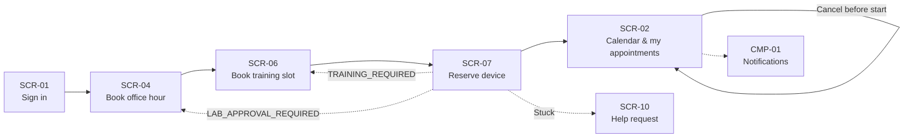
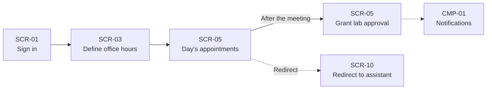
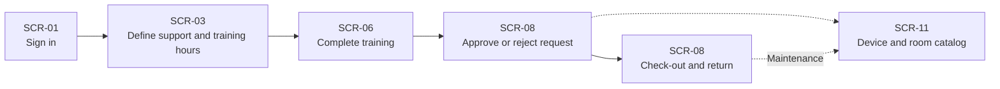
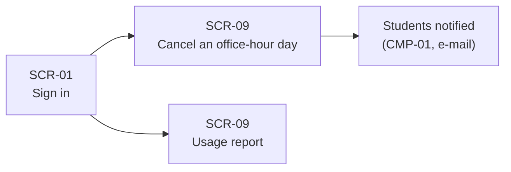
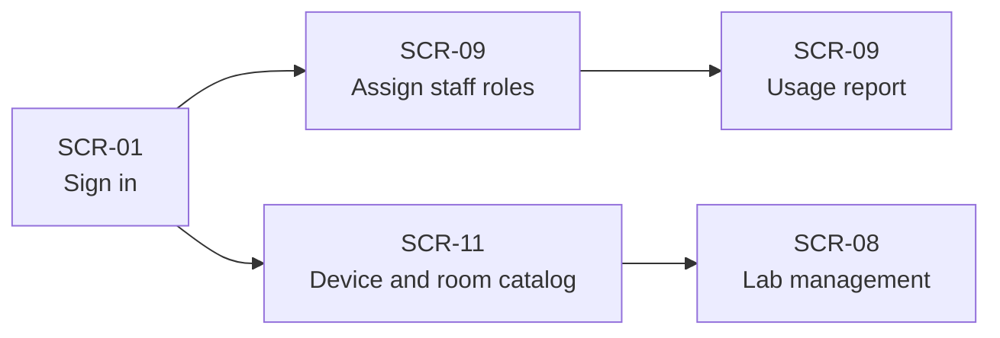

# Bookademic — UI Prototypes (Figma)

| Field | Value |
|---|---|
| File | `docs/sprint2/ui-prototypes.md` |
| Sprint | 2 |
| Issue | Refs #67 |
| Author | Emir (M4 – Office Hours) |
| Figma file | [Bookademic UI Prototypes](https://www.figma.com/design/ehxDJIgA44wXwVTPlbrzy8/Bookademic-UI-Prototypes?node-id=0-1) (view access for anyone with the link) |
| PNG exports | `docs/sprint2/figma/` (one PNG per frame, named after the frame) |
| Related docs | `docs/ui-screens.md` (screen list and flows), `docs/sprint2/srs.md` §8.1 (traceability), `docs/api/openapi.yaml` v0.2.3 |
| Language rule | All UI text is in English. |

## 1. Purpose

This document links the Figma prototypes to the screen list in `docs/ui-screens.md`. Frontend work in Sprint 2 follows the Figma file, this document and the OpenAPI contract. If a screen differs between Figma and `ui-screens.md`, `ui-screens.md` is updated or the difference is raised in the PR.

## 2. Figma file structure

| Figma page | Content |
|---|---|
| `Main journey` | The MVP screens with error variants, connected as a clickable prototype (flow `MVP journey`). |
| `Other screens and states` | The remaining screens, empty states and error states (static frames). |

## 3. Screen to Figma frame map

Frame names in Figma use the same codes as `ui-screens.md`. The FR column follows `docs/sprint2/srs.md` §8.1 (FR → screen).

| Code | Screen | Role | Story | FR | Priority | Figma frame | Figma page | Status |
|---|---|---|---|---|---|---|---|---|
| SCR-01 | Sign In & Register | All users | US-01, US-02 | FR-M1-01 … FR-M1-04 | Must | `SCR-01 Sign In & Register` | Main journey | Ready for review |
| SCR-02 | Calendar & My Appointments | Student | US-10, US-09 | FR-M2-05, FR-M2-08, FR-M2-10, FR-M2-11, FR-M4-05 | Calendar: Should · Cancel: Must | `SCR-02 Calendar & My Appointments` | Other screens and states | Ready for review |
| SCR-03 | Office Hours Management | Instructor, Research Assistant | US-17 | FR-M4-01, FR-M4-02 | Must | `SCR-03 Office Hours Management` | Other screens and states | Ready for review |
| SCR-04 | Book Appointment | Student | US-18 | FR-M4-02 … FR-M4-04 | Must | `SCR-04 Book Appointment` | Main journey | Ready for review |
| SCR-05 | Daily Appointments & Lab Approval | Instructor | US-19, US-13 | FR-M3-04, FR-M3-05, FR-M4-06 | Must | `SCR-05 Daily Appointments & Lab Approval` | Main journey | Ready for review |
| SCR-06 | Device Training & Authorization | Student, Research Assistant | US-18, US-14 | FR-M3-07, FR-M3-08, FR-M4-03, FR-M4-04 | Must | `SCR-06 Device Training & Authorization` | Main journey | Ready for review |
| SCR-07 | Lab Catalog & Reservation | Student | US-12, US-06 | FR-M2-01 … FR-M2-06, FR-M3-03, FR-M3-05, FR-M3-06, FR-M3-08 | Must | `SCR-07 Lab Catalog & Reservation` | Main journey | Ready for review |
| SCR-08 | Lab Management & Check-out/Return | Research Assistant, Admin | US-08, US-13, US-15, US-16 | FR-M2-07 … FR-M2-09, FR-M3-06, FR-M3-09 … FR-M3-11 | US-08, US-13: Must · others: Should | `SCR-08 Lab Management & Check-out and Return` | Main journey | Ready for review |
| SCR-09 | Secretary & Admin Management | Secretary, Admin | US-20, US-05, US-03 | FR-M1-05, FR-M1-06, FR-M1-09, FR-M4-07 | US-20: Must · others: Should | `SCR-09 Secretary & Admin Management` | Other screens and states | Ready for review |
| SCR-10 | Redirect & Help Request | Instructor, Student | US-21, US-22 | FR-M4-08, FR-M4-09 | Should | `SCR-10 Redirect & Help Request` | Other screens and states | Ready for review |
| SCR-11 | Device/Room Catalog Management | Research Assistant, Admin | US-11 | FR-M3-01, FR-M3-02 | Must | `SCR-11 Device and Room Catalog Management` | Other screens and states | Ready for review |
| CMP-01 | Notification Center (header component) | All signed-in roles | US-04 | FR-M1-07, FR-M1-08, FR-M3-08 | Must (in-app) | `CMP-01 Notification Center` | Other screens and states | Ready for review |
| ERR-403 | Forbidden page | All signed-in roles | US-02 | FR-M1-04 | Must | `ERR-403 Forbidden page` | Other screens and states | Ready for review |

Status values: Not started · Draft · Ready for review · Approved by PO.

Frames on `Other screens and states` are static images. They are not connected in the prototype.

PNG exports of all frames are in `docs/sprint2/figma/`. The file name of each PNG is the frame name.

## 4. Prototype scope

- **Must screens first:** SCR-01, SCR-03, SCR-04, SCR-05, SCR-06, SCR-07, SCR-08 (approval part), SCR-11 and CMP-01.
- **Should screens:** SCR-02 calendar, SCR-08 check-out/return and maintenance, SCR-09 report and role assignment, SCR-10.
- **Clickable flow (`MVP journey`):** SCR-01 → SCR-04 → SCR-05 → SCR-06 → SCR-07 → SCR-08. Navigation is on the primary buttons of each screen. Text fields are not editable in the prototype.

## 5. User flows by role

One flow per role. Screen codes are the same as in section 3; the role–screen access follows `docs/ui-screens.md` §3. The `MVP journey` in Figma is the cross-role demo path (section 4); the diagrams below show what each role does on its own.

### 5.1 Student

### 5.2 Instructor

### 5.3 Research Assistant

### 5.4 Secretary

### 5.5 Admin

## 6. States covered in Figma

Error and empty states are separate frames (frame name + ` / ` + state name).

| Screen | State frames |
|---|---|
| SCR-01 | Error (invalid sign-in) |
| SCR-02 | Empty list |
| SCR-03 | Error 409 |
| SCR-04 | Error 409 (`SLOT_UNAVAILABLE`) |
| SCR-07 | Error variant (missing approval or training) |
| SCR-11 | Error 409 |
| ERR-403 | Forbidden page |

List screens that have no separate loading frame use the populated frame as the reference.

Empty-state example (SCR-02, frame `SCR-02 … / Empty`): "You have no records this week. You can book an appointment from an office hour." with a link to SCR-04. Filtered lists with no match (SCR-07 catalog) show "No results found." All empty-state texts are in `docs/ui-screens.md` §6.

## 7. Error messages

Messages in Figma follow `docs/ui-screens.md` §8 (server `code` → message). Key states to design:

| `code` | Screen | Message |
|---|---|---|
| `INVALID_INTERVAL` | SCR-04, SCR-07 | "The selected time has already started." |
| `SLOT_UNAVAILABLE` | SCR-04, SCR-06, SCR-07 | "The selected time is already taken. Please choose another time." |
| `DAILY_APPOINTMENT_LIMIT` | SCR-04 | "You can book only one appointment per day with the same staff member (instructor or research assistant)." |
| `LAB_APPROVAL_REQUIRED` | SCR-07 | "You need lab access approval from an instructor for this device." + link to SCR-04 |
| `TRAINING_REQUIRED` | SCR-07 | "You need to complete training for this device category." + link to SCR-06 |
| `FORBIDDEN` (403) | Any screen (ERR-403 page) | "You do not have permission to access this page." |

## 8. Review and approval

| Step | Owner | Status |
|---|---|---|
| Figma file shared with the team | Emir | Done |
| Figma PR opened | Emir | Done (this PR) |
| Product Owner approval | Melih (PO) | Waiting |

## 9. Out of scope

Pixel-level visual design, mobile app, live queue, messaging (see `docs/sprint1/vision.md` §3.2).
